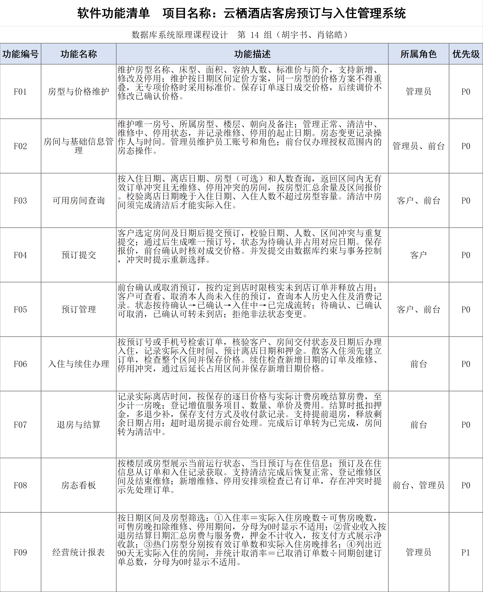

# 云栖酒店客房预订与入住管理系统

> 四川大学《数据库系统原理》课程设计（2026 学年）· **第 14 组**


面向中小型酒店的客房管理系统：客户按日期区间查询可用房间并在线预订，前台办理入住、退房与费用结算并调度房态，
管理员维护房型、房间与价格并查看入住率和营业收入统计。数据库层用**日期区间排他约束**保证同一房间在重叠日期内
绝不会被重复预订 —— 这是本项目的技术核心，也是课程评分中数据库部分（占 50%）的主要得分点。

---

## 1 选题说明

| 项 | 内容 |
| --- | --- |
| 题目类型 | 给定方案（方案六） |
| 教师原题名 | 酒店房间预订与入住管理系统 |
| 本组项目名 | **云栖酒店客房预订与入住管理系统** |
| 指导教师 | 郭际香 |
| 小组成员 | 胡宇书（组长）、肖铭皓 |

酒店客房业务的核心矛盾是**房间在时间维度上的独占性**：同一间房在同一晚只能卖给一位客户，而一位客户可能连住多晚、
也可能续住或提前退房。系统把“预订 / 入住 / 结算 / 房态”建成相互关联的数据对象，围绕 *预订 → 入住 → 退房 → 统计*
主链路展开；不扩展为完整酒店信息系统（不含会员营销、渠道直连、硬件对接）。

## 2 技术栈

| 层次 | 选型 | 说明 |
| --- | --- | --- |
| 数据库 | **PostgreSQL 18** | `daterange` 类型 + GiST 排他约束；库名 `yunqi_hotel`，UTF-8，Asia/Shanghai |
| 后端 | **Django 6.1**（Python 3.12.7） | 服务端模板渲染，单进程 `runserver`，不拆前后端 |
| 前端 | **AdminLTE 3.2 + Bootstrap 4.6** | 本地静态文件（不用 CDN），统计图表用 ECharts |
| 驱动 | psycopg2 2.9.13 | Django 原生 PostgreSQL 后端 |

**SQL 优先原则**：业务约束尽量下沉到数据库（`CHECK` / 部分唯一索引 / `EXCLUDE`），应用层只负责提示文案；
可用房查询、入住率、月度营收等多表统计一律手写 SQL（`connection.cursor()`），不使用 ORM 自动生成 ——
报告第 4 章需要贴真实执行的 SQL。

## 3 核心设计：同一房间的日期区间排他约束

`reservation` 表保留 `check_in_date` / `check_out_date` 两个 `date` 列，另建生成列把区间变成 `daterange`，
再用 GiST 排他约束保证“同一房间 + 重叠区间 + 有效状态”三者不能同时成立：

```sql
ALTER TABLE reservation
  ADD COLUMN during daterange
  GENERATED ALWAYS AS (daterange(check_in_date, check_out_date, '[)')) STORED;

ALTER TABLE reservation
  ADD CONSTRAINT ex_reservation_room_overlap
  EXCLUDE USING gist (room_id WITH =, during WITH &&)
  WHERE (status IN ('pending', 'confirmed', 'checked_in'));
```

半开区间 `'[)'` 让“退房当天可再次入住”成立；冲突时 PostgreSQL 返回 SQLSTATE **23P01**，后端捕获后
翻译成中文提示（如“该房间在 3 月 12 日–3 月 15 日已被预订”），不会抛 500。

围绕这条主约束还有三处配套设计（详见 [`docs/02-数据库设计.md`](docs/02-数据库设计.md)）：

- **房态只表达当下物理可用性**：`room.status` 四态 `available / cleaning / maintenance / disabled`；
  “已预订”“入住中”由订单与入住记录推导，不写进房态字段。
- **维修/停用区间化**：`room_block` 存日期区间（`during` + `ex_room_block_overlap` 排他），
  与有效订单冲突时由 `fn_check_reservation_block()` / `fn_check_room_block_order()` 以 SQLSTATE 23514 拒绝；
  可用房查询与入住率的分母都按它扣减。
- **逐日成交价格**：`reservation_price` 一行一晚（`UNIQUE (reservation_id, stay_date)`），
  下单或续住时由触发器固化，后续调价不影响已确认价格；`reservation.total_amount` 由触发器汇总维护。

## 4 功能清单

共 9 项功能（课程要求 5–10 项），F01–F08 为本期必做（P0），F09 为增强项（P1）。



| 编号 | 功能名称 | 所属角色 | 优先级 |
| --- | --- | --- | --- |
| F01 | 房型与价格维护 | 管理员 | P0 |
| F02 | 房间与基础信息管理 | 管理员、前台 | P0 |
| F03 | 可用房间查询 | 客户、前台 | P0 |
| F04 | 预订提交 | 客户 | P0 |
| F05 | 预订管理 | 客户、前台 | P0 |
| F06 | 入住与续住办理 | 前台 | P0 |
| F07 | 退房与结算 | 前台 | P0 |
| F08 | 房态看板 | 前台、管理员 | P0 |
| F09 | 经营统计报表 | 管理员 | P1 |

功能描述（逐条含校验、状态机与数据库约束）、业务规则与 11 类异常用例见 [`docs/01-功能清单.md`](docs/01-功能清单.md)。

## 5 数据库设计概要

共 **13 张表**（全部为正式表）：

| 表 | 作用 |
| --- | --- |
| `app_user` | 账号与角色（customer / receptionist / admin） |
| `customer` | 客户资料（姓名、证件、手机号；散客无账号） |
| `room_type` | 房型（名称、床型、面积、容纳人数、标准价） |
| `room` | 具体房间（房号唯一、所属房型、楼层、朝向、四态房态） |
| `room_block` | 维修/停用**区间**（半开区间 + 排他约束，与订单互斥） |
| `rate_plan` | 按日期区间的定价方案（同房型区间不重叠） |
| `reservation` | 预订（预订号、区间、状态、金额） |
| `reservation_price` | 逐日成交价格（一行一晚，后续调价不影响已确认价格） |
| `check_in_record` | 入住记录（实际入住/离店时间、押金、房费与服务费） |
| `payment` | 支付记录（押金、房费、服务费、退款；结算方式） |
| `room_status_log` | 房态变更日志（变更人、时间、前后状态） |
| `service_item` | 增值服务项目（早餐、洗衣、接送等） |
| `service_order` | 增值服务消费明细（单价快照 + 金额生成列，并入 F07 结算） |

约束统一显式命名（`pk_` / `fk_` / `uq_` / `ck_` / `idx_` 前缀），每张表与字段均带 `COMMENT`，便于报告直接引用。

## 6 目录结构

```
yunqi-hotel-pms/
├─ docs/                        课程文档与设计文档
│  ├─ 00-作业要求与格式要点.md   课程要求事实提取
│  ├─ 方案对比-六方案评估.md     选题决策依据（6 方案加权打分）
│  ├─ 自定选题候选.md           自拟题目备选（未采用）
│  ├─ 01-功能清单.md            项目名 / 描述 / 角色 / 9 项功能 / 异常清单
│  ├─ 02-数据库设计.md          ER 关系、13 表结构、约束清单、索引、触发器与视图、数据样例
│  ├─ 03-实施计划.md            里程碑、WBS、风险、测试验收
│  ├─ 05-查询结果与测试记录.md    Q1–Q8 实测结果（报告第 4 章素材）
│  ├─ 页面约定.md               14 个业务页 + 3 个错误页的 URL/模板/表单字段契约
│  └─ 2026学年…docx             教师下发原件（只读）
├─ deliverables/                对外交付件（第一次提交）
│  ├─ 第14组_酒店客房预订与入住管理系统.docx    文件名按给定方案名（内部项目名云栖…）
│  ├─ 第14组_酒店客房预订与入住管理系统_功能清单.xlsx
│  └─ images/feature-list.png   300 dpi 表格截图
├─ tools/                       文档解析、交付件生成与种子数据生成脚本
├─ sql/                         00_database / 01_schema / 02_constraints / 03_seed / 04_queries（均已实跑）
└─ src/                         （待建）Django 工程
```

## 7 交付进度

- [x] 选题定案、功能清单（9 项）、技术路线与实施计划
- [x] **第一次提交材料**（2026-11-12 截止）：功能清单 Excel + 表格截图 + Word 汇总（含「四、数据库要点」）
- [x] 数据库设计：ER 关系、13 张表、约束与索引、种子数据（`sql/00–04` 全部 psql 实跑通过）
- [ ] 系统实现：Django + AdminLTE 界面，预订 / 入住 / 结算主链路（11/13 – 12/04）
- [ ] 统计报表、异常处理、测试与截图（12/05 – 12/11）
- [ ] 课程报告、PPT 与现场检查（第 15–16 周）

排期、WBS 与风险清单见 [`docs/03-实施计划.md`](docs/03-实施计划.md)。

## 8 交付件复现

`deliverables/` 下的 Excel 与 Word 均由 `tools/` 脚本生成，表格内容同源，不手工编辑二进制文件：

```powershell
# 1) 生成功能清单 Excel
python tools/build_submission_xlsx.py
# 2) 渲染 300 dpi 表格截图（LibreOffice）到 deliverables/images/
# 3) 生成 Word 汇总（内嵌上一步截图）
python tools/build_submission_docx.py
# 4) 结构与版式自检，EXIT=0 即全绿
python tools/verify_submission.py
```

需要 Python 3.12 + `python-docx` + `openpyxl`；截图渲染使用 LibreOffice（或 WPS / Excel 导出图片替代）。

## 9 课程约束（团队内部约定）

- 评分构成：系统演示 60%、报告及其他 40%；其中界面 20%、功能 20%、异常处理 10%、**数据库 50%**。
- 报告版式：A4、正文小四号宋体、行距 20 磅、标题小二号黑体、摘要 150 字左右，6 章结构固定。
- 数据库表不少于 5 张（本项目 **13 张**，全部为正式表），功能点 5–10 项（本项目 9 项）。
- 教师下发原件只读，派生文档另起文件名；所有 SQL 脚本必须可在演示库直接执行。
