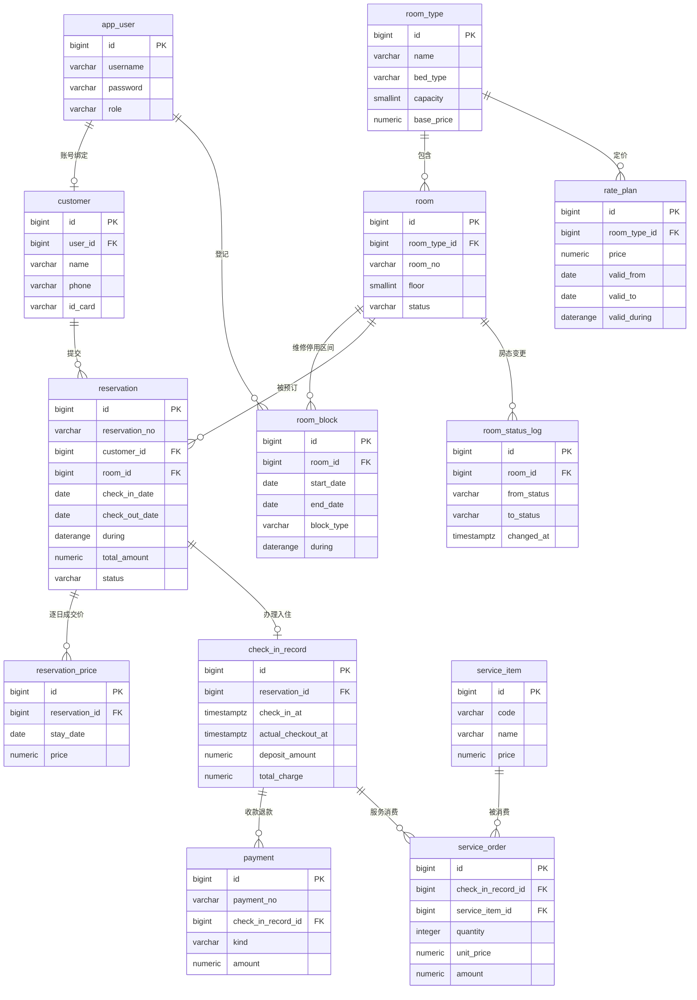
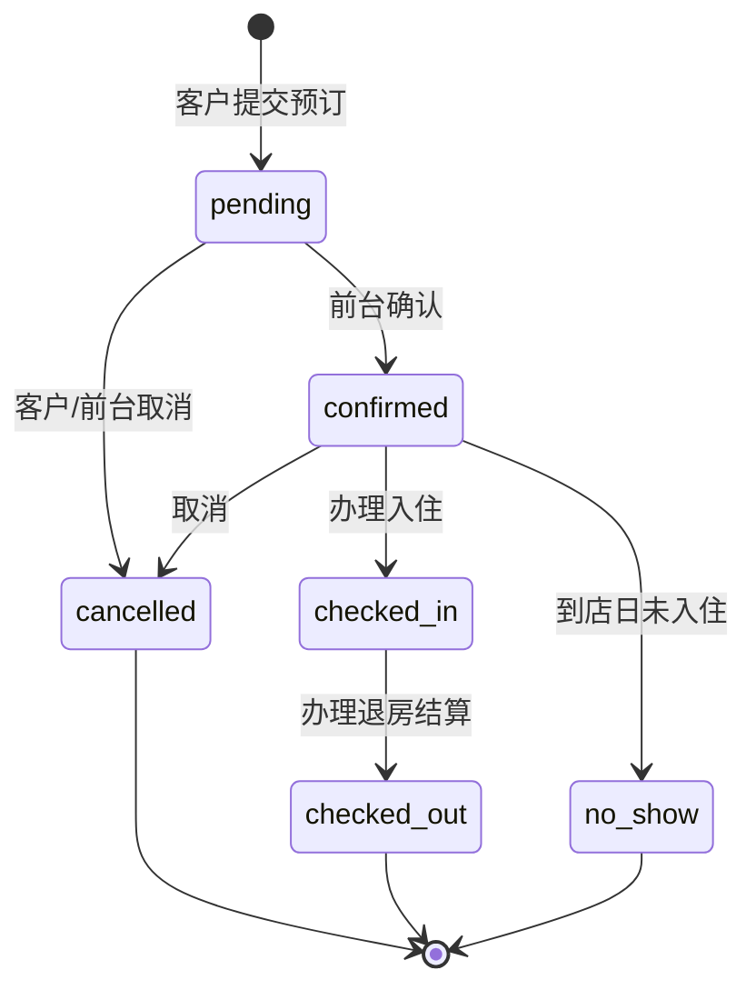
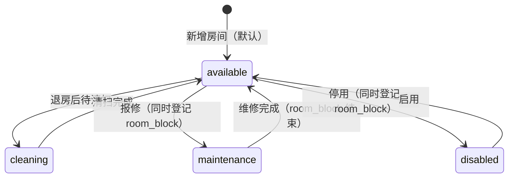

# 02 数据库设计

> 项目：云栖酒店客房预订与入住管理系统（第 14 组）
> 对应脚本：`sql/01_schema.sql`（建表）、`sql/02_constraints.sql`（生成列 / 排他约束 / 触发器 / 视图 / 函数）、`sql/03_seed.sql`（样例数据）
> 状态：**13 张表口径已定案；01 / 02 / 03 三个脚本均已 psql 实跑通过**（2026-10-30）。本文与 `sql/` 冲突时以 `sql/` 为准，冲突点集中在 §13。
> 本文是报告 3.2 的素材池：3.2.1 ER 图、3.2.2 表结构与约束、3.2.3 数据样例都从这里取，不要另写一份。

## 1 设计目标与策略

课程评分里数据库设计占 50%，所以本项目的策略是**把业务规则尽量下沉到数据库**，应用层只负责把错误翻译成中文提示：

1. **数据完整性交给约束**：主外键、`CHECK`、`UNIQUE`、`EXCLUDE`。硬性规则（同一房间不能重叠预订、同一客户不能重复占用、同一房型的调价方案不能重叠、维修区间不能与订单重叠）全部在库里拦住，不依赖前端校验。
2. **状态可追溯**：房态变更写 `room_status_log`，谁在何时把房间从什么状态改成什么状态都有据可查（触发器 `trg_room_status_log` 自动写，操作人由事务内的 `SET LOCAL app.current_user_id` 传入）。
3. **时间用范围类型**：预订占用、维修区间、价格方案都用 `daterange` 生成列 + GiST 排他约束表达；`timestamptz` 存时刻，不用字符串存日期。
4. **约束显式命名**：`pk_` / `fk_` / `uq_` / `ck_` / `ex_` / `idx_` 前缀，报告 3.2.2 与答辩时可以逐条指认。
5. **一切可重复执行**：脚本先 `DROP … CASCADE` 再重建，种子先 `TRUNCATE … RESTART IDENTITY CASCADE` 再插入，任何一次演示都能从零跑通，不依赖手工点选。
6. **房态只表达当下物理可用性**：`room.status` 的取值收敛为 `available` / `cleaning` / `maintenance` / `disabled` 四态；“已预订”“入住中”不写进房态字段，而是由 `reservation` 与 `check_in_record` 推导。这样房态字段不会被“未来的预订”污染，看板上的“在住 / 待入住”永远是真实现状。
7. **计数与统计口径跟随提交件**：表数 13、房态 4 态、营业收入按退房结算日期归月、入住率可售房夜扣维修停用房夜 —— 这几条口径与 `docs/01-功能清单.md` 及胡宇书版提交件文案一致，本文、`sql/`、报告三处不再各自表述。

## 2 实体与关系（ER）

### 2.1 关系说明

| 关系 | 基数 | FK 方向 | 说明 |
| --- | --- | --- | --- |
| `app_user` ↔ `customer` | 1 : 0..1 | `customer.user_id` → `app_user.id` | 有账号的客户才绑定档案；线下散客无账号，`customer.user_id` 为空 |
| `customer` → `reservation` | 1 : N | `reservation.customer_id` → `customer.id` | 一个客户可多次预订 |
| `room_type` → `room` | 1 : N | `room.room_type_id` → `room_type.id` | 一个房型下多个房间 |
| `room_type` → `rate_plan` | 1 : N | `rate_plan.room_type_id` → `room_type.id` | 一个房型可有多个日期区间的价格方案（区间互不重叠） |
| `room` → `room_block` | 1 : N | `room_block.room_id` → `room.id` | 一个房间可有多段维修 / 停用区间（同一房间的区间互不重叠） |
| `room` → `reservation` | 1 : N | `reservation.room_id` → `room.id` | 一个房间在不同日期可被多次预订（生效区间互斥） |
| `reservation` → `reservation_price` | 1 : N | `reservation_price.reservation_id` → `reservation.id` | 一张订单 = 若干房晚，一房晚一行成交价；随订单区间变化自动增删 |
| `reservation` → `check_in_record` | 1 : 0..1 | `check_in_record.reservation_id` → `reservation.id` | 预订办理入住后产生一条入住记录，最多一条 |
| `check_in_record` → `payment` | 1 : N | `payment.check_in_record_id` → `check_in_record.id` | 一次入住可有多笔收款 / 退款 |
| `check_in_record` → `service_order` | 1 : N | `service_order.check_in_record_id` → `check_in_record.id` | 入住期间的增值服务消费 |
| `service_item` → `service_order` | 1 : N | `service_order.service_item_id` → `service_item.id` | 服务项目被多次消费 |
| `room` → `room_status_log` | 1 : N | `room_status_log.room_id` → `room.id` | 房间状态每次变更一条日志（只记 4 态） |
| `app_user` → `payment` / `room_status_log` / `room_block` | 1 : N | `payment.operator_user_id`、`room_status_log.changed_by`、`room_block.created_by` → `app_user.id` | 记录经办人 / 操作人 / 登记人（均可空，系统自动操作时为空） |

### 2.2 ER 图（Mermaid 草稿）

> 报告里的插图用此图导出（draw.io 或 Mermaid CLI），导出后放 `docs/images/er.png` 并在报告 3.2.1 引用。



## 3 核心设计（答辩主攻点）

### 3.1 `date` 列 + 生成列 `during` + `EXCLUDE` 排他约束

报告 3.2.2 用列清单展示表结构时，`check_in_date` / `check_out_date` 两个 `date` 列最好读、最好和界面字段对应。因此业务字段保留两个 `date` 列，另加生成列承载区间语义：

```sql
ALTER TABLE reservation
    ADD COLUMN during daterange
    GENERATED ALWAYS AS (daterange(check_in_date, check_out_date, '[)')) STORED;

ALTER TABLE room_block
    ADD COLUMN during daterange
    GENERATED ALWAYS AS (daterange(start_date, end_date, '[)')) STORED;

ALTER TABLE rate_plan
    ADD COLUMN valid_during daterange
    GENERATED ALWAYS AS (daterange(valid_from, valid_to, '[]')) STORED;
```

`during` 由数据库计算，业务代码不需要维护第三个字段，也就不可能写下与两个 `date` 列不一致的区间。排他约束直接建在生成列上：

```sql
CREATE EXTENSION IF NOT EXISTS btree_gist;   -- bigint 等值比较需要

ALTER TABLE reservation
    ADD CONSTRAINT ex_reservation_room_overlap
    EXCLUDE USING gist (room_id WITH =, during WITH &&)
    WHERE (status IN ('pending', 'confirmed', 'checked_in'));
```

含义：只要两行预订**房间相同**且**日期区间相交**，并且两行都处于“仍占用房间”的状态，数据库就拒绝插入 / 更新。三个设计细节，答辩时必被问：

| 细节 | 取值 | 原因 |
| --- | --- | --- |
| 区间开闭 | `[)` 半开区间 | 12-01 入住、12-03 离店只占 12-01、12-02 两晚；12-03 当天房间可再卖，不会少卖一天 |
| `WHERE` 过滤 | `pending` / `confirmed` / `checked_in` 三态 | 已取消、已退房、未到店不再占用房间，历史单不能阻塞新房 |
| `btree_gist` | 必须建扩展 | GiST 原生不支持 `bigint =`，缺扩展会报 `operator class "bigint_ops" does not exist` |

`rate_plan` 用闭区间 `[valid_from, valid_to]`（“到哪天为止”含当天），约束名 `ex_rate_plan_no_overlap`；`room_block` 与 `reservation` 一致用半开区间 `[)`，约束名 `ex_room_block_overlap`。

### 3.2 维修 / 停用区间 `room_block` 与跨表校验触发器

原来的做法是给 `room.status` 加 `maintenance` / `disabled` 两个值就完事。问题是**房态是一个“当下”快照**，回答不了这几类真问题：

1. “12 月 15 日这间房能不能卖？”—— 8 月登记“12-01 到 12-20 空调检修”时房态还是 `available`，到 12 月 1 日才变，中间 3 个月系统会照卖；
2. 一段维修结束要恢复，谁记得把房态改回来？改早了房间在修，改晚了白空一晚；
3. 一段时间内的停用（如整层改造到明年 6 月）根本没法用一个当前状态表达“未来某天恢复”；
4. 房态变更日志只能记“谁在何时改了标签”，不能记“这段日期不可售、原因是什么”。

所以本项目把“不可售”拆成两层：**房态字段**只表示当下的物理可用性（`available` / `cleaning` / `maintenance` / `disabled`，看板与日志用）；**`room_block` 区间**表示某房间在某段日期内不可售，是可用房判定与入住率分母的唯一依据：

```sql
CREATE TABLE room_block (
    id          bigserial    NOT NULL,
    room_id     bigint       NOT NULL,
    start_date  date         NOT NULL,
    end_date    date         NOT NULL,
    block_type  varchar(20)  NOT NULL,
    reason      varchar(200),
    created_by  bigint,
    created_at  timestamptz  NOT NULL DEFAULT now(),
    CONSTRAINT pk_room_block          PRIMARY KEY (id),
    CONSTRAINT fk_room_block_room     FOREIGN KEY (room_id) REFERENCES room (id) ON DELETE CASCADE,
    CONSTRAINT fk_room_block_operator FOREIGN KEY (created_by) REFERENCES app_user (id) ON DELETE SET NULL,
    CONSTRAINT ck_room_block_type     CHECK (block_type IN ('maintenance', 'disabled')),
    CONSTRAINT ck_room_block_range    CHECK (end_date > start_date)
);
```

区间内部不重叠由 `ex_room_block_overlap` 保证；**跨表**（维修区间 ↔ 有效订单）不重叠没法用一条 `EXCLUDE` 表达，于是用两个方向相反的 `BEFORE` 触发器兜住：

| 方向 | 触发器 | 函数 | 拒绝条件 | SQLSTATE |
| --- | --- | --- | --- | --- |
| 订单落库 / 改期 / 改状态前 | `trg_reservation_block_check` | `fn_check_reservation_block()` | 订单状态属于三态且与 `room_block` 区间相交 | `23514` |
| 登记维修 / 停用前 | `trg_room_block_order_check` | `fn_check_room_block_order()` | 该区间内已有三态订单 | `23514` |

```sql
CREATE TRIGGER trg_reservation_block_check
    BEFORE INSERT OR UPDATE OF room_id, check_in_date, check_out_date, status ON reservation
    FOR EACH ROW EXECUTE FUNCTION fn_check_reservation_block();

CREATE TRIGGER trg_room_block_order_check
    BEFORE INSERT OR UPDATE ON room_block
    FOR EACH ROW EXECUTE FUNCTION fn_check_room_block_order();
```

`fn_check_room_block_order()` 里写区间用的是 `daterange(NEW.start_date, NEW.end_date, '[)')` 现算而不是 `NEW.during`，原因写在函数注释里：`during` 是 `STORED` 生成列，PostgreSQL 在 `BEFORE` 触发器**之后**才计算生成列，此时 `NEW.during` 还是空值。

两个函数的报错文案直接给人看（Django 侧按 SQLSTATE 与 `constraint_name` 判定，不匹配中文）：

- `fn_check_reservation_block()`：`房间 % 在 % ~ % 之间处于维修/停用状态，不可预订`，`HINT` 提示换房或调整日期；
- `fn_check_room_block_order()`：`该房间在 % ~ % 之间存在有效订单，请先处理订单再登记维修/停用`，`HINT` 提示先取消订单或改选区间。

房态与区间的一致性由应用层同事务维护（登记维修时顺手把 `room.status` 改成 `maintenance`，维修结束改回 `available`），但**可用房判定两者都查**，所以即使房态标签忘了改，`room_block` 也能挡住超卖。

### 3.3 逐日成交价格 `reservation_price` 与两个触发器

价格有三类事实要同时成立：节假日按方案加价、下单后调价不影响已确认订单、续住的新房晚按新价。只存一个 `reservation.price_per_night` 做不到，所以拆出逐日明细表：

```sql
CREATE TABLE reservation_price (
    id             bigserial     NOT NULL,
    reservation_id bigint        NOT NULL,
    stay_date      date          NOT NULL,
    price          numeric(10,2) NOT NULL,
    created_at     timestamptz   NOT NULL DEFAULT now(),
    CONSTRAINT pk_reservation_price              PRIMARY KEY (id),
    CONSTRAINT fk_reservation_price_reservation  FOREIGN KEY (reservation_id) REFERENCES reservation (id) ON DELETE CASCADE,
    CONSTRAINT uq_reservation_price_day          UNIQUE (reservation_id, stay_date),
    CONSTRAINT ck_reservation_price_price        CHECK (price >= 0)
);
```

一订单一行一个房晚，`uq_reservation_price_day` 既是幂等的冲突目标（`ON CONFLICT DO NOTHING`），也是级联删除的检索索引。明细由两个 `AFTER` 触发器维护，链式但不递归：

| 触发器 | 时机 | 函数 | 作用 |
| --- | --- | --- | --- |
| `trg_reservation_price_sync` | `reservation` 上 `AFTER INSERT OR UPDATE OF room_id, check_in_date, check_out_date` | `fn_sync_reservation_prices()` | 删掉区间外的旧房晚，补齐区间内缺失的房晚 |
| `trg_reservation_price_total` | `reservation_price` 上 `AFTER INSERT OR UPDATE OR DELETE` | `fn_refresh_reservation_total()` | 把 `sum(price)` 与均价回写 `reservation.total_amount` / `price_per_night` |

取价规则（同步触发器与 `fn_stay_total_price()` 完全一致）：某房型当天命中 `rate_plan`（`valid_during @> 当天`，多条命中取 `valid_from` 最新、再按 `id` 兜底）就用方案价，否则用 `room_type.base_price`。

三条业务承诺在库里如何落地：

1. **“后续调价不影响已确认价格”**：明细一旦生成就固化为 `reservation_price.price`。之后改 `rate_plan.price` 或新增方案，不会回写任何历史明细，`total_amount` 也不会变。
2. **“续住按新价”**：续住 = 更新 `check_out_date`。同步触发器先 `DELETE` 区间外房晚（改期）或什么都不删（仅延长），再用 `ON CONFLICT (reservation_id, stay_date) DO NOTHING` 补缺失房晚 —— 已有房晚保留原成交价，新增房晚按**当下**的方案价 / 标准价取价。
3. **“总额永远等于逐日之和”**：汇总触发器在明细任何变动后重算 `total_amount = sum(price)`、`price_per_night = round(sum / 晚数, 2)`。下单时 `total_amount` / `price_per_night` 是 `NOT NULL`，应用先给初值，触发器随后覆盖为真实值。两个函数只写这两列、不动 `room_id` 与两个日期列，因此不会再触发 `trg_reservation_price_sync`，不存在递归。

`fn_stay_total_price(p_room_type_id, p_check_in, p_check_out)` 是同一取价规则的整段房费函数，`fn_available_rooms()` 的价格列与它同源，保证“查询报的价”与“下单算的价”是同一套规则。

### 3.4 边界用例 B1–B12

| # | 场景 | 前一条数据 | 后一条数据 | 期望结果 | 拦截者 |
| --- | --- | --- | --- | --- | --- |
| B1 | 完全重叠 | `[12-01, 12-03)` | `[12-01, 12-03)` | 拒绝，SQLSTATE `23P01` | `ex_reservation_room_overlap` |
| B2 | 部分重叠 | `[12-01, 12-03)` | `[12-02, 12-04)` | 拒绝，`23P01` | `ex_reservation_room_overlap` |
| B3 | 首尾相接 | `[12-01, 12-03)` | `[12-03, 12-05)` | **允许**（半开区间语义） | — |
| B4 | 前一条已取消 | `[12-01, 12-03)` 状态 `cancelled` | `[12-01, 12-03)` | 允许（`WHERE` 过滤掉已取消） | — |
| B5 | 前一条已退房 | `[12-01, 12-03)` 状态 `checked_out` | 同区间 | 允许 | — |
| B6 | 同客户同房同区间重复提交 | — | 同客户 | 拒绝，`23505` | `uq_reservation_active_customer` |
| B7 | 跨年 | `[12-30, 01-02)` | `[01-01, 01-03)` | 拒绝（`daterange` 跨年无特殊处理） | `ex_reservation_room_overlap` |
| B8 | 价格方案重叠 | 房型 A `[10-01, 10-07]` | 房型 A `[10-05, 10-10]` | 拒绝 | `ex_rate_plan_no_overlap` |
| B9 | 价格方案相接 | 房型 A `[10-01, 10-07]` | 房型 A `[10-08, 10-10]` | 允许（闭区间，可相邻不可重叠） | — |
| B10 | 订单落在维修区间内 | 房间 A 维修 `[12-10, 12-12)` | 订单 `[12-11, 12-13)` | 拒绝，`23514` | `trg_reservation_block_check` |
| B11 | 维修区间压住有效订单 | 房间 A 订单 `[12-03, 12-06)` | 维修 `[12-02, 12-06)` | 拒绝，`23514` | `trg_room_block_order_check` |
| B12 | 改期后逐日明细与总额重算 | 订单 `[12-03, 12-05)`，2 行明细、总额 200 | 改期为 `[12-03, 12-06)` | 明细变 3 行、总额 300、均价 100 | `trg_reservation_price_sync` + `trg_reservation_price_total` |

`sql/02_constraints.sql` 末尾的 DO 块把 B2 / B3 / B10 / B11 / B12 真的插一遍，断言写在块里（`v_price_cnt <> 2` 之类直接 `RAISE EXCEPTION`），跑脚本即可看到真实 SQLSTATE 与报错文本。

**实测记录（2026-10-30，PostgreSQL 18）**：

- B2（`__TEST__-2` 插 `[12-02, 12-04)`，与 `__TEST__-1` 的 `[12-01, 12-03)` 相交）→ 被拒，SQLSTATE `23P01`，`SQLERRM` 为中文的“互相冲突的键值违反排他约束”并附约束名 `ex_reservation_room_overlap`；
- B3（`__TEST__-3` 插 `[12-03, 12-05)`）→ 成功，验证离店日当天可被下一位客人入住；
- B10 / B11 → 均被 `23514` 拒绝，NOTICE 打在 psql 输出里；
- B12（`__TEST__-3` 改为 `[12-03, 12-06)`）→ 明细 2 行变 3 行、总额 200 → 300；
- 自检临时数据已按外键顺序清理（`reservation_price` 随订单级联删除），不留测试行。

注意：PG 的错误消息文本随实例 `lc_messages` 变化，**Django 侧按异常类与 `diag.constraint_name` 判定，不要匹配中文文案**。

### 3.5 部分唯一索引（防重复提交）

```sql
CREATE UNIQUE INDEX uq_reservation_active_customer
    ON reservation (customer_id, room_id, check_in_date, check_out_date)
    WHERE status IN ('pending', 'confirmed', 'checked_in');
```

用于 E03（客户重复提交同一区间），抛 `23505`；与 `EXCLUDE` 互补：前者管“同一客户重复下单”，后者管“房间被别人抢”。

## 4 状态机

### 4.1 预订状态（六态）



- `checked_in` 只能由入住办理写入，且必须同时创建 `check_in_record`；
- `checked_out` 必须在结算完成（`payment` 覆盖 `total_charge`）后写入；
- E05（取消已入住订单）、E06（重复入住 / 重复结算）在应用层按状态机拦截，数据库侧兜底靠两条：`ck_reservation_status` 保证状态值合法，`uq_check_in_record_reservation` 保证一单只能入住一次。

### 4.2 房间状态（四态）



**预订状态与房态是解耦的**：房态里没有“已预订”“入住中”，这两个事实由数据推导 —— 某房间在查询区间内存在 `pending` / `confirmed` 订单即为“已预订”，存在未退房的 `check_in_record` 即为“入住中”。好处是房态字段只反映物理可用性，不需要为“未来某天的预订”提前改状态，也不存在订单取消后房态忘改回来的问题。

`room_status_log` 只记这 4 态流转，`from_status` / `to_status` 的 `CHECK` 同样限定 4 态；预订状态变化不写日志。

## 5 表清单

共 **13 张正式表**：原有业务表（账号客户 → 房型房间价格 → 预订 → 入住支付 → 房态日志 → 增值服务）加上本轮新增的 `room_block`（维修 / 停用区间）与 `reservation_price`（逐日成交价格）。旧表数口径的说法一律作废；`service_item` / `service_order` 是正式表，接入 F07 结算。13 张满足课程“≥5 张表”的要求。

| # | 表名 | 用途 | 关键约束 | 实际行数（`sql/03_seed.sql`） | 报告位置 |
| --- | --- | --- | --- | --- | --- |
| **账号与客户** | | | | | |
| 1 | `app_user` | 账号与角色 | `uq_app_user_username`、`ck_app_user_role` | 27（1 管理员 + 2 前台 + 24 客户账号） | 3.2.2 |
| 2 | `customer` | 客户档案（含线下散客） | `uq_customer_phone`、`uq_customer_id_card`、`uq_customer_user` | 30（24 有账号 + 6 散客） | 3.2.2、3.2.3 |
| **房型、房间与价格** | | | | | |
| 3 | `room_type` | 房型与标准价 | `uq_room_type_name`、`ck_room_type_capacity` | 6 | 3.2.2、4.1（Q5） |
| 4 | `room` | 房间（4 态房态） | `uq_room_room_no`、`ck_room_status` | 40 | 3.2.2、4.1（Q1） |
| 5 | `rate_plan` | 日期区间价格方案 | `ex_rate_plan_no_overlap` | 10 | 3.2.2、3.3 |
| **预订与逐日价格** | | | | | |
| 6 | `reservation` | 预订主表（核心） | `ex_reservation_room_overlap`、`uq_reservation_active_customer`、`ck_reservation_date_order` | 96 | 3.2.2、3.2.3、4.2（Q2） |
| 7 | `reservation_price` | 逐日成交价格 | `uq_reservation_price_day`、`fk_reservation_price_reservation`（CASCADE） | 239（= 96 单房晚总数，触发器生成） | 3.3、4.2（Q4） |
| **入住与支付** | | | | | |
| 8 | `check_in_record` | 入住与结算记录 | `uq_check_in_record_reservation`、`ck_check_in_record_amounts` | 48（40 已退房 + 8 在住） | 3.2.2、4.2（Q3/Q4） |
| 9 | `payment` | 支付 / 退款流水 | `uq_payment_no`、`ck_payment_kind` | 96（48 押金 + 37 房费 + 3 退款 + 8 服务费） | 3.2.2、4.3（Q7） |
| **日志与封禁** | | | | | |
| 10 | `room_status_log` | 房态变更日志（4 态） | `ck_room_status_log_from` / `_to` | 11（手工 7 + 触发器 4） | 3.2.2、4.3（Q3） |
| 11 | `room_block` | 维修 / 停用日期区间 | `ex_room_block_overlap`、`ck_room_block_range`、跨表触发器校验 | 4（3 段维修 + 1 段停用） | 3.2.2、3.4、4.1（Q1/Q3） |
| **增值服务** | | | | | |
| 12 | `service_item` | 增值服务项目 | `uq_service_item_code` / `_name` | 8 | 3.2.2 |
| 13 | `service_order` | 增值服务消费明细 | `fk_service_order_check_in_record`（CASCADE）、`ck_service_order_quantity` | 57 | 3.2.2、4.3（Q7） |

增值服务两张表**已实现并接入 F07 结算**：`check_in_record.service_charge` = 该入住记录所有 `service_order.amount` 之和，`payment` 里有对应的 `service_fee` 流水；`service_order.amount` 是生成列（`quantity * unit_price`），单价用消费时快照（`unit_price`），不随 `service_item.price` 变化而改写历史账单。

## 6 表结构（报告 3.2.2 直接取用）

字段顺序与 `sql/01_schema.sql` 一致；“约束”列只写该列相关的命名约束，表级约束集中列在 §7。金额一律 `numeric(10,2)`，时刻一律 `timestamptz`。

### 6.1 app_user 账号表

| 字段 | 类型 | 约束 | 说明 |
| --- | --- | --- | --- |
| `id` | `bigserial` | PK `pk_app_user` | 主键 |
| `username` | `varchar(50)` | NOT NULL，`uq_app_user_username` | 登录名，全局唯一 |
| `password` | `varchar(128)` | NOT NULL | Django PBKDF2 密码哈希，不存明文 |
| `display_name` | `varchar(50)` | NOT NULL | 显示姓名 |
| `role` | `varchar(20)` | NOT NULL DEFAULT `customer`，`ck_app_user_role` | `customer` / `receptionist` / `admin` |
| `phone` | `varchar(20)` | | 联系电话 |
| `email` | `varchar(120)` | | 邮箱 |
| `is_active` | `boolean` | NOT NULL DEFAULT true | 停用而不删除，保留历史外键 |
| `last_login` | `timestamptz` | | 最近登录时间 |
| `created_at` / `updated_at` | `timestamptz` | NOT NULL DEFAULT `now()` | `updated_at` 由 `trg_app_user_updated_at` 维护 |

### 6.2 customer 客户档案

| 字段 | 类型 | 约束 | 说明 |
| --- | --- | --- | --- |
| `id` | `bigserial` | PK `pk_customer` | |
| `user_id` | `bigint` | FK `fk_customer_user` → `app_user(id)` ON DELETE SET NULL，`uq_customer_user` | 有账号才绑定；散客为空 |
| `name` | `varchar(50)` | NOT NULL | 客户姓名 |
| `phone` | `varchar(20)` | NOT NULL，`uq_customer_phone` | 前台按手机号查预订 |
| `id_card` | `varchar(18)` | `uq_customer_id_card`，`ck_customer_id_card` 长度 15 或 18 | 身份证号 |
| `email` | `varchar(120)` | | |
| `remark` | `varchar(200)` | | 备注（如“常客，偏好高楼层”） |
| `created_at` / `updated_at` | `timestamptz` | NOT NULL DEFAULT `now()` | `trg_customer_updated_at` |

### 6.3 room_type 房型

| 字段 | 类型 | 约束 | 说明 |
| --- | --- | --- | --- |
| `id` | `bigserial` | PK `pk_room_type` | |
| `name` | `varchar(50)` | NOT NULL，`uq_room_type_name` | 如“高级大床房” |
| `bed_type` | `varchar(20)` | NOT NULL，`ck_room_type_bed_type` | `single` / `double` / `twin` / `king` / `family` / `suite` |
| `area` | `numeric(5,1)` | `ck_room_type_area`（>0） | 建筑面积（㎡） |
| `capacity` | `smallint` | NOT NULL，`ck_room_type_capacity`（1–8） | 可住人数 |
| `base_price` | `numeric(10,2)` | NOT NULL，`ck_room_type_base_price`（≥0） | 标准价；无价格方案时使用 |
| `description` | `varchar(200)` | | 房型描述 |
| `is_active` | `boolean` | NOT NULL DEFAULT true | 停用后不出现在可用房查询 |
| `created_at` / `updated_at` | `timestamptz` | NOT NULL DEFAULT `now()` | `trg_room_type_updated_at` |

### 6.4 room 房间

| 字段 | 类型 | 约束 | 说明 |
| --- | --- | --- | --- |
| `id` | `bigserial` | PK `pk_room` | |
| `room_type_id` | `bigint` | NOT NULL，FK `fk_room_room_type` ON DELETE RESTRICT | 所属房型 |
| `room_no` | `varchar(10)` | NOT NULL，`uq_room_room_no` | 房号，唯一（如 `801`） |
| `floor` | `smallint` | NOT NULL，`ck_room_floor`（-2–99） | 楼层 |
| `orientation` | `varchar(10)` | `ck_room_orientation` | `north` / `south` / `east` / `west` |
| `status` | `varchar(20)` | NOT NULL DEFAULT `available`，`ck_room_status` | **4 态**：`available` / `cleaning` / `maintenance` / `disabled`，只表示当下物理可用性 |
| `remark` | `varchar(200)` | | 备注 |
| `created_at` / `updated_at` | `timestamptz` | NOT NULL DEFAULT `now()` | `trg_room_updated_at` |

`status` 的语义边界是本项目的关键口径：已预订、入住中**不在这里**，由 `reservation` / `check_in_record` 推导；某段日期的维修 / 停用看 `room_block`。

### 6.5 room_block 维修 / 停用区间（新增）

| 字段 | 类型 | 约束 | 说明 |
| --- | --- | --- | --- |
| `id` | `bigserial` | PK `pk_room_block` | |
| `room_id` | `bigint` | NOT NULL，FK `fk_room_block_room` ON DELETE CASCADE | 房间；房间删除时区间一并删 |
| `start_date` | `date` | NOT NULL | 封禁开始日（含） |
| `end_date` | `date` | NOT NULL，`ck_room_block_range`（`end_date > start_date`） | 结束日（**不含**）：半开区间，`end_date` 当天恢复可售 |
| `block_type` | `varchar(20)` | NOT NULL，`ck_room_block_type` | `maintenance` 维修中 / `disabled` 停用 |
| `reason` | `varchar(200)` | | 封禁原因（如“空调机组检修”） |
| `created_by` | `bigint` | FK `fk_room_block_operator` ON DELETE SET NULL | 登记人；账号删除后置空 |
| `created_at` | `timestamptz` | NOT NULL DEFAULT `now()` | 登记时间 |
| `during` | `daterange` | 生成列 `daterange(start_date, end_date, '[)')` STORED | 供 `ex_room_block_overlap` 与可用房查询使用 |

表级约束：`ex_room_block_overlap`（同一房间区间不重叠）。跨表约束由 `trg_room_block_order_check` 保证（不进 §7.4）。

### 6.6 rate_plan 价格方案

| 字段 | 类型 | 约束 | 说明 |
| --- | --- | --- | --- |
| `id` | `bigserial` | PK `pk_rate_plan` | |
| `room_type_id` | `bigint` | NOT NULL，FK `fk_rate_plan_room_type` ON DELETE CASCADE | 所属房型 |
| `name` | `varchar(50)` | | 如“国庆加价·标准间” |
| `price` | `numeric(10,2)` | NOT NULL，`ck_rate_plan_price`（≥0） | 该区间每晚价格 |
| `valid_from` / `valid_to` | `date` | NOT NULL，`ck_rate_plan_range`（`valid_to >= valid_from`） | 生效起止日（**含**两端） |
| `valid_during` | `daterange` | 生成列 `daterange(valid_from, valid_to, '[]')` STORED | 供 `ex_rate_plan_no_overlap` 使用 |
| `created_at` / `updated_at` | `timestamptz` | NOT NULL DEFAULT `now()` | `trg_rate_plan_updated_at` |

### 6.7 reservation 预订主表（核心）

| 字段 | 类型 | 约束 | 说明 |
| --- | --- | --- | --- |
| `id` | `bigserial` | PK `pk_reservation` | |
| `reservation_no` | `varchar(20)` | NOT NULL，`uq_reservation_no` | 业务预订号，如 `R20261203001` |
| `customer_id` | `bigint` | NOT NULL，FK `fk_reservation_customer` ON DELETE RESTRICT | 预订客户 |
| `room_id` | `bigint` | NOT NULL，FK `fk_reservation_room` ON DELETE RESTRICT | 预订房间 |
| `check_in_date` | `date` | NOT NULL | 入住日（含） |
| `check_out_date` | `date` | NOT NULL，`ck_reservation_date_order`（`>`） | 离店日（不含） |
| `during` | `daterange` | 生成列 `daterange(check_in_date, check_out_date, '[)')` STORED | 供排他约束与可用房查询使用 |
| `guest_count` | `smallint` | NOT NULL DEFAULT 1，`ck_reservation_guest_count`（>0） | 入住人数 |
| `price_per_night` | `numeric(10,2)` | NOT NULL，`ck_reservation_price`（≥0） | 平均成交单价，= `total_amount ÷ 晚数`，由 `fn_refresh_reservation_total()` 维护 |
| `total_amount` | `numeric(10,2)` | NOT NULL，`ck_reservation_price`（≥0） | 订单总金额 = `reservation_price` 逐日之和，由触发器维护 |
| `status` | `varchar(20)` | NOT NULL DEFAULT `pending`，`ck_reservation_status` | 六态，见 §4.1 |
| `source` | `varchar(20)` | NOT NULL DEFAULT `online`，`ck_reservation_source` | `online` / `phone` / `walk_in` |
| `remark` | `varchar(200)` | | |
| `created_at` / `updated_at` | `timestamptz` | NOT NULL DEFAULT `now()` | `trg_reservation_updated_at` |

表级约束：`ex_reservation_room_overlap`（防超卖）、`uq_reservation_active_customer`（防重复提交）。金额两列虽为 `NOT NULL`，但业务值由触发器回写，应用插入时给占位初值即可。

### 6.8 reservation_price 逐日成交价格（新增）

| 字段 | 类型 | 约束 | 说明 |
| --- | --- | --- | --- |
| `id` | `bigserial` | PK `pk_reservation_price` | |
| `reservation_id` | `bigint` | NOT NULL，FK `fk_reservation_price_reservation` ON DELETE CASCADE | 所属预订；订单删除时明细级联删除 |
| `stay_date` | `date` | NOT NULL，`uq_reservation_price_day (reservation_id, stay_date)` | 该房晚日期（入住日含、离店日不含） |
| `price` | `numeric(10,2)` | NOT NULL，`ck_reservation_price_price`（≥0） | 该晚成交价，固化后不随 `rate_plan` 调价变化 |
| `created_at` | `timestamptz` | NOT NULL DEFAULT `now()` | 明细生成时间 |

行数恒等于订单房晚数；触发器生成，应用不直接写本表（续住 / 改期只改订单日期）。

### 6.9 check_in_record 入住与结算

| 字段 | 类型 | 约束 | 说明 |
| --- | --- | --- | --- |
| `id` | `bigserial` | PK `pk_check_in_record` | |
| `reservation_id` | `bigint` | NOT NULL，FK `fk_check_in_record_reservation` ON DELETE RESTRICT，`uq_check_in_record_reservation` | 一条预订最多一条入住记录 |
| `guest_name` / `guest_phone` | `varchar(50)` / `varchar(20)` | NOT NULL | 实际入住人（可与预订人不同） |
| `guest_id_card` | `varchar(18)` | `ck_check_in_record_guest_id` 长度 15/18 | 实际入住人证件 |
| `check_in_at` | `timestamptz` | NOT NULL DEFAULT `now()` | 实际入住时刻 |
| `actual_checkout_at` | `timestamptz` | `ck_check_in_record_time_order`（不早于入住） | 实际退房时刻；为空表示仍在住，**也是营业收入归月的依据** |
| `deposit_amount` | `numeric(10,2)` | NOT NULL DEFAULT 0，`ck_check_in_record_amounts`（≥0） | 押金（不计入营业收入） |
| `room_charge` | `numeric(10,2)` | 同上 | 房费 = 实住天数 × 适用房价 |
| `service_charge` | `numeric(10,2)` | 同上 | 增值服务费合计 |
| `total_charge` | `numeric(10,2)` | 同上 | 应收合计 = 房费 + 服务费 |
| `remark` | `varchar(200)` | | |
| `created_at` / `updated_at` | `timestamptz` | NOT NULL DEFAULT `now()` | `trg_check_in_record_updated_at` |

### 6.10 payment 支付 / 退款流水

| 字段 | 类型 | 约束 | 说明 |
| --- | --- | --- | --- |
| `id` | `bigserial` | PK `pk_payment` | |
| `payment_no` | `varchar(20)` | NOT NULL，`uq_payment_no` | 流水号（如 `P20261215096`） |
| `check_in_record_id` | `bigint` | NOT NULL，FK `fk_payment_check_in_record` ON DELETE CASCADE | 所属入住记录 |
| `kind` | `varchar(20)` | NOT NULL，`ck_payment_kind` | `deposit` / `room_fee` / `service_fee` / `refund` |
| `method` | `varchar(20)` | NOT NULL，`ck_payment_method` | `cash` / `card` / `wechat` / `alipay` |
| `amount` | `numeric(10,2)` | NOT NULL，`ck_payment_amount`（≥0） | 退款也记正数，用 `kind` 区分方向 |
| `paid_at` | `timestamptz` | NOT NULL DEFAULT `now()` | 收付时间（只用于流水检索，不再用于营收归月） |
| `operator_user_id` | `bigint` | FK `fk_payment_operator` ON DELETE SET NULL | 经办前台 |
| `remark` | `varchar(200)` | | |

### 6.11 room_status_log 房态变更日志

| 字段 | 类型 | 约束 | 说明 |
| --- | --- | --- | --- |
| `id` | `bigserial` | PK `pk_room_status_log` | |
| `room_id` | `bigint` | NOT NULL，FK `fk_room_status_log_room` ON DELETE CASCADE | 房间 |
| `from_status` | `varchar(20)` | `ck_room_status_log_from` | 变更前（首次为空） |
| `to_status` | `varchar(20)` | NOT NULL，`ck_room_status_log_to` | 变更后 |
| `changed_by` | `bigint` | FK `fk_room_status_log_user` ON DELETE SET NULL | 操作人；系统自动变更时为空 |
| `changed_at` | `timestamptz` | NOT NULL DEFAULT `now()` | 变更时间 |
| `reason` | `varchar(200)` | | 变更原因（触发器写入固定文案） |

`from_status` / `to_status` 只接受 4 态，与 `room.status` 的 `ck_room_status` 保持一致。

### 6.12 service_item 增值服务项目

| 字段 | 类型 | 约束 | 说明 |
| --- | --- | --- | --- |
| `id` | `bigserial` | PK `pk_service_item` | |
| `code` | `varchar(20)` | NOT NULL，`uq_service_item_code` | 服务编码（`BF` / `LD` / `AP` …） |
| `name` | `varchar(50)` | NOT NULL，`uq_service_item_name` | 服务名称（自助早餐 / 洗衣服务 / 机场接送 …） |
| `unit` | `varchar(10)` | NOT NULL DEFAULT `份` | 计量单位 |
| `price` | `numeric(10,2)` | NOT NULL，`ck_service_item_price`（≥0） | 单价 |
| `is_active` | `boolean` | NOT NULL DEFAULT true | 是否在售 |
| `created_at` | `timestamptz` | NOT NULL DEFAULT `now()` | |

### 6.13 service_order 增值服务消费

| 字段 | 类型 | 约束 | 说明 |
| --- | --- | --- | --- |
| `id` | `bigserial` | PK `pk_service_order` | |
| `check_in_record_id` | `bigint` | NOT NULL，FK `fk_service_order_check_in_record` ON DELETE CASCADE | 所属入住记录 |
| `service_item_id` | `bigint` | NOT NULL，FK `fk_service_order_service_item` ON DELETE RESTRICT | 服务项目 |
| `quantity` | `integer` | NOT NULL，`ck_service_order_quantity`（>0） | 数量 |
| `unit_price` | `numeric(10,2)` | NOT NULL，`ck_service_order_unit_price`（≥0） | 消费时单价快照 |
| `amount` | `numeric(10,2)` | 生成列 `quantity * unit_price` STORED | 金额（不手写） |
| `ordered_at` | `timestamptz` | NOT NULL DEFAULT `now()` | 消费时间 |

## 7 约束清单（答辩逐条指认用）

### 7.1 主键与唯一

| 约束名 | 表 | 定义 | 业务含义 |
| --- | --- | --- | --- |
| `pk_*` | 全部 13 张表 | `PRIMARY KEY (id)` | 代理主键 |
| `uq_app_user_username` | `app_user` | `UNIQUE (username)` | 登录名不重名 |
| `uq_customer_user` | `customer` | `UNIQUE (user_id)` | 一个账号只能绑一个客户档案 |
| `uq_customer_phone` | `customer` | `UNIQUE (phone)` | 手机号即客户身份，防重复建档 |
| `uq_customer_id_card` | `customer` | `UNIQUE (id_card)` | 同一身份证不得重复建档 |
| `uq_room_type_name` | `room_type` | `UNIQUE (name)` | 房型名唯一 |
| `uq_room_room_no` | `room` | `UNIQUE (room_no)` | 房号唯一 |
| `uq_reservation_no` | `reservation` | `UNIQUE (reservation_no)` | 预订号唯一 |
| `uq_reservation_price_day` | `reservation_price` | `UNIQUE (reservation_id, stay_date)` | 一单一房晚只有一行成交价；也是 `ON CONFLICT` 目标 |
| `uq_check_in_record_reservation` | `check_in_record` | `UNIQUE (reservation_id)` | E06：一单不能入住两次 |
| `uq_payment_no` | `payment` | `UNIQUE (payment_no)` | 流水号唯一 |
| `uq_service_item_code` / `uq_service_item_name` | `service_item` | `UNIQUE` | 服务编码 / 名称唯一 |

### 7.2 外键与删除策略

| 约束名 | 子表.列 | 父表 | 删除策略 | 原因 |
| --- | --- | --- | --- | --- |
| `fk_customer_user` | `customer.user_id` | `app_user` | SET NULL | 账号注销后保留客户档案与历史单 |
| `fk_room_room_type` | `room.room_type_id` | `room_type` | RESTRICT | E08：房型下有房间不能删，改停用 |
| `fk_room_block_room` | `room_block.room_id` | `room` | CASCADE | 房间删除时其维修 / 停用区间一并清理 |
| `fk_room_block_operator` | `room_block.created_by` | `app_user` | SET NULL | 登记人离职不影响历史区间 |
| `fk_rate_plan_room_type` | `rate_plan.room_type_id` | `room_type` | CASCADE | 房型删除时价格方案随之清理 |
| `fk_reservation_customer` | `reservation.customer_id` | `customer` | RESTRICT | 有历史订单的客户不能删 |
| `fk_reservation_room` | `reservation.room_id` | `room` | RESTRICT | 有历史订单的房间不能删 |
| `fk_reservation_price_reservation` | `reservation_price.reservation_id` | `reservation` | CASCADE | 订单删除时逐日明细一并清理（自检数据靠它清场） |
| `fk_check_in_record_reservation` | `check_in_record.reservation_id` | `reservation` | RESTRICT | 结算记录不能失去来源 |
| `fk_payment_check_in_record` | `payment.check_in_record_id` | `check_in_record` | CASCADE | 入住记录删除时流水一并清 |
| `fk_payment_operator` | `payment.operator_user_id` | `app_user` | SET NULL | 经办人离职不影响流水 |
| `fk_room_status_log_room` | `room_status_log.room_id` | `room` | CASCADE | 房间删除时日志随之清 |
| `fk_room_status_log_user` | `room_status_log.changed_by` | `app_user` | SET NULL | 操作人离职不影响日志 |
| `fk_service_order_check_in_record` | `service_order.check_in_record_id` | `check_in_record` | CASCADE | 入住记录删除时服务明细一并清 |
| `fk_service_order_service_item` | `service_order.service_item_id` | `service_item` | RESTRICT | 服务项目被消费过不能删，改停用 |

共 15 条外键。总原则：**财务与审计类记录（订单、结算、日志）向上用 RESTRICT，防止历史断链；纯明细（逐日价格、支付流水、服务明细、房态日志、封禁区间）用 CASCADE，随主记录清场；人员引用统一 SET NULL。**

### 7.3 CHECK 约束（全表，共 30 条）

| 约束名 | 定义 | 拦截的异常 |
| --- | --- | --- |
| `ck_app_user_role` | `role IN ('customer','receptionist','admin')` | 非法角色 |
| `ck_customer_id_card` | 长度 15 或 18（可空） | 证件号格式 |
| `ck_room_type_bed_type` | `IN ('single','double','twin','king','family','suite')` | 非法床型 |
| `ck_room_type_area` | `area IS NULL OR area > 0` | 面积非法 |
| `ck_room_type_capacity` | `BETWEEN 1 AND 8` | 人数非法 |
| `ck_room_type_base_price` | `base_price >= 0` | 负价格 |
| `ck_room_floor` | `BETWEEN -2 AND 99` | 楼层非法 |
| `ck_room_orientation` | 可空，`IN ('north','south','east','west')` | 朝向非法 |
| `ck_room_status` | **4 态** `IN ('available','cleaning','maintenance','disabled')` | 非法房态（含已废弃的 reserved/occupied） |
| `ck_room_block_type` | `IN ('maintenance','disabled')` | 非法封禁类型 |
| `ck_room_block_range` | `end_date > start_date` | 空区间 / 倒置日期 |
| `ck_rate_plan_price` | `price >= 0` | 负价格 |
| `ck_rate_plan_range` | `valid_to >= valid_from` | 倒置区间 |
| `ck_reservation_date_order` | `check_out_date > check_in_date` | 同日或倒置日期（E01 的第一道库内保障） |
| `ck_reservation_guest_count` | `guest_count > 0` | 人数为 0 |
| `ck_reservation_price` | `price_per_night >= 0 AND total_amount >= 0` | 负金额 |
| `ck_reservation_status` | 六态枚举 | 非法状态 |
| `ck_reservation_source` | `IN ('online','phone','walk_in')` | 非法来源 |
| `ck_reservation_price_price` | `price >= 0` | 逐日成交价为负 |
| `ck_check_in_record_time_order` | `actual_checkout_at IS NULL OR actual_checkout_at >= check_in_at` | 退房早于入住 |
| `ck_check_in_record_amounts` | 四项费用均 ≥ 0 | 负押金 / 负房费 |
| `ck_check_in_record_guest_id` | 证件长度 15/18（可空） | 证件格式 |
| `ck_payment_kind` | `IN ('deposit','room_fee','service_fee','refund')` | 非法支付类型 |
| `ck_payment_method` | `IN ('cash','card','wechat','alipay')` | 非法支付方式 |
| `ck_payment_amount` | `amount >= 0` | 负金额（退款也是正数 + `kind`） |
| `ck_room_status_log_from` | 可空，4 态 | 非法前状态 |
| `ck_room_status_log_to` | NOT NULL，4 态 | 非法后状态 |
| `ck_service_item_price` | `price >= 0` | 负价格 |
| `ck_service_order_quantity` | `quantity > 0` | 数量为 0 / 负 |
| `ck_service_order_unit_price` | `unit_price >= 0` | 负单价 |

### 7.4 排他约束（EXCLUDE，3 条）

| 约束名 | 表 | 定义 | 拦截的异常 |
| --- | --- | --- | --- |
| `ex_reservation_room_overlap` | `reservation` | `gist (room_id WITH =, during WITH &&) WHERE status IN ('pending','confirmed','checked_in')` | **超卖**（E02）与自重叠（B1/B2/B7） |
| `ex_rate_plan_no_overlap` | `rate_plan` | `gist (room_type_id WITH =, valid_during WITH &&)` | 同一房型调价方案区间重叠（B8） |
| `ex_room_block_overlap` | `room_block` | `gist (room_id WITH =, during WITH &&)` | 同一房间维修 / 停用区间重叠 |

三条都由 `btree_gist` 支撑；`pg_constraint` 里 `contype = 'x'` 恰好 3 行，报告可截图。

### 7.5 部分唯一索引

| 索引名 | 表 | 定义 | 拦截的异常 |
| --- | --- | --- | --- |
| `uq_reservation_active_customer` | `reservation` | `UNIQUE (customer_id, room_id, check_in_date, check_out_date) WHERE status IN ('pending','confirmed','checked_in')` | 客户重复提交（E03，`23505`） |

### 7.6 跨表触发器校验（EXCLUDE 表达不了的规则）

| 触发器 | 表 / 时机 | 校验内容 | 拒绝时 SQLSTATE |
| --- | --- | --- | --- |
| `trg_reservation_block_check` | `reservation`，`BEFORE INSERT OR UPDATE OF room_id, check_in_date, check_out_date, status` | 三态订单的区间不得与 `room_block` 相交（B10） | `23514` |
| `trg_room_block_order_check` | `room_block`，`BEFORE INSERT OR UPDATE` | 新登记的封禁区间内不得有生效订单（B11） | `23514` |

这两个校验是“两张表各存一段区间”的必然产物：`EXCLUDE` 只能约束单表，跨表区间互斥只能靠触发器；两个方向都要查，否则从任一侧插入都能绕过。

## 8 索引设计

| 索引名 | 表 | 列 | 用途 |
| --- | --- | --- | --- |
| `idx_room_block_room_dates` | `room_block` | `(room_id, start_date, end_date)` | 可用房查询按房间排除封禁区间、封禁列表按房号检索 |
| `idx_reservation_customer` | `reservation` | `(customer_id)` | 我的预订列表（F05，Q2） |
| `idx_reservation_room_dates` | `reservation` | `(room_id, check_in_date, check_out_date)` | 房态看板按房查占用（F08）、可用房 `NOT EXISTS` 子查询 |
| `idx_reservation_status` | `reservation` | `(status)` | 前台按待确认 / 待入住筛选 |
| `idx_payment_record` | `payment` | `(check_in_record_id)` | 结算页取流水、`v_check_in_detail` 聚合 |
| `idx_payment_paid_at` | `payment` | `(paid_at)` | 按收付时间检索流水（注意：营收归月已改用 `actual_checkout_at`） |
| `idx_room_status_log_room` | `room_status_log` | `(room_id, changed_at DESC)` | 房态追溯按时间倒序 |
| `idx_service_order_record` | `service_order` | `(check_in_record_id)` | 结算页取服务明细 |

另有 4 类“隐式索引”，报告里可一并说明：

- 13 个主键索引与 12 个唯一约束索引（含 `uq_reservation_price_day`）；
- `uq_reservation_active_customer` 部分唯一索引；
- 3 条 `EXCLUDE` 约束各创建一个同名 GiST 索引（`ex_reservation_room_overlap` / `ex_rate_plan_no_overlap` / `ex_room_block_overlap`），可用 `pg_indexes` 看到。

## 9 触发器、视图与函数

### 9.1 触发器（12 个）

| 触发器 | 表 | 时机 | 作用 |
| --- | --- | --- | --- |
| `trg_app_user_updated_at` | `app_user` | BEFORE UPDATE FOR EACH ROW | 刷新 `updated_at` |
| `trg_customer_updated_at` | `customer` | 同上 | 同上 |
| `trg_room_type_updated_at` | `room_type` | 同上 | 同上 |
| `trg_room_updated_at` | `room` | 同上 | 同上 |
| `trg_rate_plan_updated_at` | `rate_plan` | 同上 | 同上 |
| `trg_reservation_updated_at` | `reservation` | 同上 | 同上 |
| `trg_check_in_record_updated_at` | `check_in_record` | 同上 | 同上 |
| `trg_room_status_log` | `room` | AFTER UPDATE OF `status` | 写 `room_status_log`；操作人取 `current_setting('app.current_user_id', true)`，非法或未设置则记 NULL |
| `trg_reservation_block_check` | `reservation` | BEFORE INSERT OR UPDATE OF `room_id, check_in_date, check_out_date, status` | 订单 ↔ 维修停用区间冲突校验（`23514`） |
| `trg_room_block_order_check` | `room_block` | BEFORE INSERT OR UPDATE | 维修停用区间 ↔ 有效订单冲突校验（`23514`） |
| `trg_reservation_price_sync` | `reservation` | AFTER INSERT OR UPDATE OF `room_id, check_in_date, check_out_date` | 增删 `reservation_price` 逐日明细 |
| `trg_reservation_price_total` | `reservation_price` | AFTER INSERT OR UPDATE OR DELETE | 汇总回 `reservation.total_amount` / `price_per_night` |

前 7 个共用一个函数 `fn_set_updated_at()`；`pg_trigger` 里 `NOT tgisinternal` 恰好 12 行。

### 9.2 视图（2 个）

| 视图 | 内容 | 用途 |
| --- | --- | --- |
| `v_reservation_detail` | 预订 + 客户 + 房间 + 房型，含 `nights = check_out_date - check_in_date` 与 `avg_price`（= `reservation.price_per_night`） | 预订列表页、报告 4 章多表查询（Q2） |
| `v_check_in_detail` | 入住记录 + 已收退金额合计 `settled_amount` + 差额 `balance`（退款按 `-amount` 冲减） | 退房结算页（押金是否足够，E07）、Q7 |

### 9.3 函数（8 个）

| 函数 | 说明 | 用途 / 触发时机 |
| --- | --- | --- |
| `fn_set_updated_at()` | 通用 `updated_at` 触发器函数，`NEW.updated_at := now()` | 7 个 `trg_*_updated_at` |
| `fn_log_room_status()` | 房态日志触发器函数，`NEW.status IS DISTINCT FROM OLD.status` 时插一行日志 | `trg_room_status_log` |
| `fn_check_reservation_block()` | 订单落库前比对 `room_block`，命中即 `RAISE … ERRCODE 23514` | `trg_reservation_block_check` |
| `fn_check_room_block_order()` | 登记封禁前比对三态订单，命中即 `RAISE … ERRCODE 23514` | `trg_room_block_order_check` |
| `fn_sync_reservation_prices()` | 删区间外房晚、`ON CONFLICT DO NOTHING` 补缺失房晚（方案价或标准价） | `trg_reservation_price_sync` |
| `fn_refresh_reservation_total()` | `sum(price)` 回写 `total_amount`，均价回写 `price_per_night` | `trg_reservation_price_total` |
| `fn_stay_total_price(p_room_type_id bigint, p_check_in date, p_check_out date)` | 整段房费：逐日取价求和，返回 `numeric`；区间非法或无房型返回 0 | F03 报价、`fn_available_rooms` 复用 |
| `fn_available_rooms(p_check_in date, p_check_out date, p_room_type_id bigint DEFAULT NULL)` | 可用房查询，返回 `room_id, room_no, room_type_id, room_type_name, capacity, floor, base_price, avg_price, total_price` | F03 可用房列表；日期非法抛 `22023` |

`fn_available_rooms()` 的判定条件四条同时成立才算可售：

```sql
WHERE rt.is_active                                        -- 房型在售
  AND rm.status NOT IN ('maintenance', 'disabled')        -- 房态不是维修 / 停用
  AND NOT EXISTS (SELECT 1 FROM room_block rb            -- 无封禁区间相交
                   WHERE rb.room_id = rm.id
                     AND rb.during && daterange(p_check_in, p_check_out, '[)'))
  AND NOT EXISTS (SELECT 1 FROM reservation r            -- 无三态订单相交
                   WHERE r.room_id = rm.id
                     AND r.status IN ('pending', 'confirmed', 'checked_in')
                     AND r.during && daterange(p_check_in, p_check_out, '[)'))
```

示例（种子库，`docs/05` 有实测结果）：

```sql
SELECT room_no, room_type_name, floor, base_price, avg_price, total_price
FROM fn_available_rooms(DATE '2026-12-20', DATE '2026-12-22')
ORDER BY floor, room_no
LIMIT 5;
```

`avg_price` = `total_price ÷ 晚数`，跨国庆 / 元旦区间时与 `base_price` 不同，这正好演示“逐日取价”。

## 10 数据样例规划

详细种子数据写在 `sql/03_seed.sql`，由 `tools/build_seed_sql.py` 生成（随机种子 `20261030`），不手写。

### 10.1 规模与口径

| 表 | 行数 | 口径 |
| --- | --- | --- |
| `app_user` | 27 | 1 管理员 + 2 前台 + 24 客户账号，口令统一 `Hotel@123`（PBKDF2 哈希，`pbkdf2_sha256$1500000$…`） |
| `customer` | 30 | 24 个关联账号 + 6 个线下散客（`user_id IS NULL`，验证弱关联设计），覆盖常客 / 协议客户 / 家庭客 / 散客四类人群 |
| `room_type` | 6 | 标准间 288 / 高级大床房 388 / 豪华双床房 488 / 家庭房 688 / 行政套房 1288 / 无障碍房 328（元/晚） |
| `room` | 40 | 5–12 层，每层 5 间，房号 `5xx`–`12xx` |
| `rate_plan` | 10 | 国庆加价 5 个房型（`2026-10-01`–`10-07`）+ 元旦加价 5 个房型（`2026-12-30`–`2027-01-02`），元旦价 = 国庆价 × 0.9333… |
| `reservation` | 96 | 六态齐全，含 B3 首尾相接、B4 取消后重订两组合法边界数据 |
| `reservation_price` | 239 | 触发器生成；239 = 96 单的房晚总数，不手插 |
| `check_in_record` | 48 | 40 条已退房（`actual_checkout_at` 非空）+ 8 条在住 |
| `payment` | 96 | 押金 48（合计 11070.00）+ 房费尾款 37（47736.00）+ 退款 3（300.00）+ 在住服务费 8（1794.00） |
| `room_status_log` | 11 | 手工历史 7（房间 16 的 4 态轨迹）+ 触发器自动 4（第 12 节改 4 间房态） |
| `room_block` | 4 | 房间 1 维修 `[2026-09-10, 09-25)`（15 夜，历史）、房间 3 维修 `[2026-12-01, 12-20)`（19 夜，覆盖演示日 12-15）、房间 2 停用 `[2026-11-01, 2027-06-30)`（241 夜，楼层改造长期停用）、房间 5 维修 `[2026-12-18, 12-24)`（6 夜，**房态仍为 `available`**，专用于演示“按区间而非房态标签”排除） |
| `service_item` | 8 | 自助早餐 68 / 洗衣 30 / 机场接送 120 / 加床 150 / 午餐 88 / 晚餐 128 / SPA 268 / 停车 20 |
| `service_order` | 57 | 金额合计 8444.00，覆盖 8 个服务项目，在住记录均有 `service_charge > 0` |

状态分布（脚本 `--check` 自报，与落库一致）：

- 预订：`checked_out 40 / confirmed 16 / pending 14 / cancelled 12 / checked_in 8 / no_show 6`；
- 房态（4 态）：`available 36 / cleaning 2 / maintenance 1 / disabled 1`（第 12 节把房间 2 改 `disabled`、3 改 `maintenance`、4 与 5 改 `cleaning`）；
- 支付方式：`wechat 34 / card 31 / alipay 20 / cash 11`。

日期锚点 **2026-12-15**（演示日）：8 条在住记录覆盖 12-13 / 12-14 入住，房间 3 的维修区间覆盖 12-15，因此 12-15 当日房间 3 不可售、房间 2 因停用到 2027-06-30 也不可售 —— 演示时能直接看到“房态标签 + 封禁区间”两层同时生效。另有一对照组：房间 5 的房态是 `available`（标签没动），但 12-18~12-24 登记了维修，可用房查询照样按区间把它排除；Q1 的 12-20~12-22 窗口正好命中这段封禁，可用来证明“只靠房态标签会超卖”。

### 10.2 生成方式与断言

选择脚本生成的理由：

1. 96 条预订必须满足“同一房间的活跃区间互不重叠”，脚本在 Python 侧维护 `busy[room_id]` 区间表，落库前就做冲突检测，不靠 psql 试错；
2. 条数口径与本节完全一致，脚本生成前断言，断言不过不写文件；
3. 固定随机种子 `20261030`，改数据只改脚本再重跑，输出可 diff。

种子脚本自身可重复执行：`TRUNCATE TABLE reservation_price, room_block, service_order, service_item, payment, check_in_record, room_status_log, reservation, rate_plan, room, room_type, customer, app_user RESTART IDENTITY CASCADE` 后按外键顺序插入，整段包在事务里。

脚本末尾的 SQL 自检（报告 3.2.3 可直接截图）：

| 查询 | 期望结果 |
| --- | --- |
| 13 张表行数汇总（`UNION ALL`） | 27 / 30 / 6 / 40 / 10 / 96 / 239 / 48 / 96 / 11 / 4 / 8 / 57 |
| `reservation` 按状态分组 | 上表六态分布 |
| `room` 按状态分组 | 36 / 2 / 1 / 1 |
| `room_block` 按类型分组（含 `blocked_room_nights`） | maintenance 3 段 / 40 夜，disabled 1 段 / 241 夜 |
| `reservation_price_rows` 与 `planned_room_nights` | 两者相等，均为 239 |
| `mismatch`（`total_amount` ≠ 逐日之和的订单数） | 0 |
| `overlap_pairs`（活跃订单自重叠） | 0 |
| `blocked_overlap_pairs`（订单与封禁区间相交） | 0 |
| `payment` 按 `kind` 分组 | 48 / 11070.00、37 / 47736.00、3 / 300.00、8 / 1794.00 |
| `fn_available_rooms('2026-12-20','2026-12-22')` | 35 间（40 间 − 房态 maintenance/disabled 的 2 间 − 房间 5 的 12-18~12-24 封禁 − 该窗内的有效订单；实跑数字见 `docs/05` Q1） |
| `v_reservation_detail` / `v_check_in_detail` | 96 行 / 48 行 |

报告 3.2.3 的样例数据表直接取 `reservation` + `v_reservation_detail` 的 5–8 行，配 `sql/04_queries.sql` 的查询结果截图。

## 11 与 Django 的衔接

1. **表由 SQL 脚本创建，Django 模型 `managed = False`**：`sql/` 是唯一事实来源，避免 migration 与脚本两份 DDL 漂移；`manage.py migrate` 只建 `auth_*` / `contenttypes` / `sessions` 等框架表。自定义用户模型 `AUTH_USER_MODEL = 'core.AppUser'` 对应 `app_user` 表，13 张业务表全部不由 migration 管理。
2. **执行顺序**：`psql -f sql/00_database.sql` → `01_schema.sql` → `02_constraints.sql` → `03_seed.sql`，再 `python manage.py migrate`（只建框架表）。顺序不可颠倒：`02` 依赖 `01` 建好的表与列（生成列、`EXCLUDE`、触发器都 `ALTER` 已有表），`03` 依赖 `02` 的触发器生成逐日价格。
3. **异常映射**（`core/services.py` 或视图层统一处理）：

   | 异常 | SQLSTATE | 判定依据 | 中文文案 |
   | --- | --- | --- | --- |
   | `psycopg2.errors.ExclusionViolation` | `23P01` | `diag.constraint_name` = `ex_reservation_room_overlap` | “该房间在所选日期已被预订，请换一间或调整日期” |
   | 同上 | `23P01` | `ex_rate_plan_no_overlap` | “该房型在此日期区间已有价格方案” |
   | 同上 | `23P01` | `ex_room_block_overlap` | “该房间在此区间已有维修 / 停用登记” |
   | `psycopg2.errors.CheckViolation` | `23514` | 来自两个跨表校验触发器 | “该房间此期间处于维修 / 停用状态，或该区间已有有效订单” |
   | `psycopg2.errors.CheckViolation` | `23514` | `ck_reservation_date_order` 等 | 按约束名映射到字段提示（如“离店日期必须晚于入住日期”） |
   | `psycopg2.errors.UniqueViolation` | `23505` | `uq_reservation_active_customer` | “您已提交过相同区间、相同房间的预订” |
   | `psycopg2.errors.UniqueViolation` | `23505` | 其他 `uq_*` | “编号或手机号已存在，请检查后重试” |
   | `psycopg2.errors.InvalidParameterValue` | `22023` | `fn_available_rooms` 的日期校验 | “离店日期必须晚于入住日期” |

   判定一律用异常类 + `diag.constraint_name`，**不匹配中文报错文本**（随实例 `lc_messages` 变化）。
4. **复杂查询走手写 SQL**：可用房、入住率、月度营收都用 `connection.cursor()` 或 `QuerySet.raw()`，报告 4 章贴真实执行 SQL（对应 `sql/04_queries.sql` Q1–Q8）。
5. **事务**：办理入住 = 更新 `reservation.status` + 插入 `check_in_record`（房态 4 态不写“入住中”，占用由订单推导；若原为 `cleaning` 先置回 `available`），放在同一个 `transaction.atomic()` 里；改期 = 更新两个日期列，逐日价格与总额由触发器在同一事务内重算。业务校验失败抛 `ValidationError` → `messages.error()`，数据库抛 `IntegrityError` → 按上表翻译，不做应用层双重校验的补丁。
6. **操作人回填**：需要记经办人时，事务内先 `SET LOCAL app.current_user_id = '<用户 id>'`，`fn_log_room_status()` 用它写 `changed_by`；未设置或非法时自动记 NULL。

## 12 完成度与待办核对

- [x] `sql/01_schema.sql` / `sql/02_constraints.sql`（**13 表版**）**已实跑通过**（2026-10-30 17:22，psql 18）。实测：建表 **13 张**（`table_count = 13`）；排他约束 **3 条**（`ex_reservation_room_overlap` / `ex_rate_plan_no_overlap` / `ex_room_block_overlap`）；部分唯一索引 1 条；触发器 12 个；视图 2 个；函数 8 个。
- [x] 约束自检 DO 块（9 步）**全部通过**：重叠订单 `23P01`；首尾相接区间成功；改期后逐日明细 2 → 3 行、总额 200 → 300；订单压维修区间与维修区间压订单均 `23514`；临时数据已清理。
- [x] `sql/03_seed.sql`（636 行、4 段封禁）**已实跑通过**：13 张表行数见 §10.1；`reservation_price` **239** 行 = `planned_room_nights` 239；`mismatch = 0`、`overlap_pairs = 0`、`blocked_overlap_pairs = 0`；`fn_available_rooms(2026-12-20, 12-22)` 实测 **35 间**。
- [x] `sql/04_queries.sql`（Q1–Q8）**已按新口径重跑**，`docs/05-查询结果与测试记录.md` 数字全部刷新（Q1 35 间、Q4 按 `actual_checkout_at` 归月后 13 行、月度净收入 12400 / 23568 / 11092 / 376）。
- [ ] ER 图导出 PNG 放 `docs/images/er.png`，报告 3.2.1 引用 —— **未做**（Mermaid 源在 §2.2，导出待做）。
- [ ] 报告 3.2.2 逐表截图 `\d+ 表名`（含 COMMENT）与 `pg_constraint` 清单 —— **未做**。
- [ ] Django 工程（`src/`）尚未开始，§11 的异常映射与 `managed = False` 属设计约定，未落代码。
- 术语统一：约束命名 `ex_`（排他）、`uq_`（唯一）、`ck_`（检查）、`idx_`（普通索引），与 `docs/01` §7 示例代码一致。
- 控制台编码：Windows 下 psql 默认 GBK，脚本首行 `\encoding UTF8` 已在任何中文字面量之前生效，回显仍可能乱码，不影响入库数据。

## 13 文档一致性核对记录

本轮把上一版遗留的 4 处口径冲突逐条核实并就地修掉，不再悬而未决：

| # | 位置 | 原冲突 | 处理结果 |
| --- | --- | --- | --- |
| 1 | `sql/01_schema.sql` 的 `service_item` / `service_order` 注释 | 注释与 `COMMENT ON TABLE` 仍标“（可选）”，对应旧的 9 必选 + 2 可选口径 | **已改**：注释改为“F07 结算的组成部分 / 13 张正式表之一”，`COMMENT` 去掉“（可选）” |
| 2 | `sql/03_seed.sql` 头部的 `room_status_log` 行数 | 旧口径记 35（v1 曾改 26 间房态），与生成器自报 7 + 4 = 11 不一致 | **已核**：`03_seed` 只执行一处 `UPDATE room`（影响 4 行），**11 是正确值**；`AGENTS.md` 里的 35 属旧口径，随本轮一并更新 |
| 3 | `docs/页面约定.md` 入住提交写 `room.status='occupied'` | 6 态房态遗留，与 4 态口径冲突 | **已改**：改为“房态不写「入住中」，占用由订单推导；入住前若为 `cleaning` 须先置回 `available`” |
| 4 | `docs/01-功能清单.md` 表清单第 11 行 | `room_status_log` 仍带“（必选，用于状态可追溯）”旧措辞 | **已改**：改为「房态变更日志（状态可追溯）」 |

`room_block` 第 4 段（房间 5，12-18~12-24，房态保持 `available`）是本轮新加的演示样本，§3.2、§5、§10.1 均已同步。
