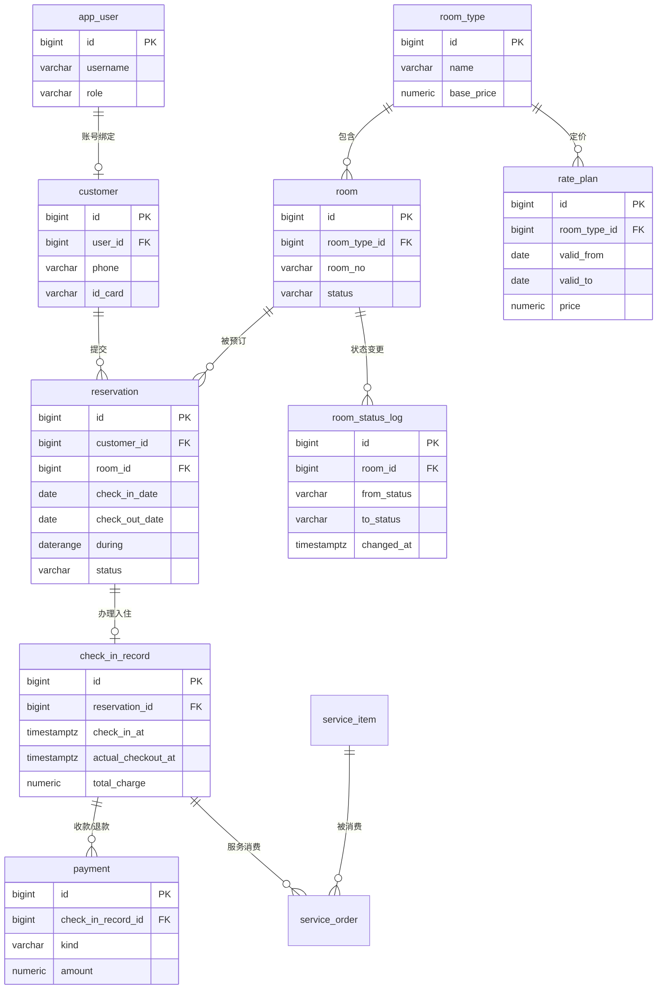
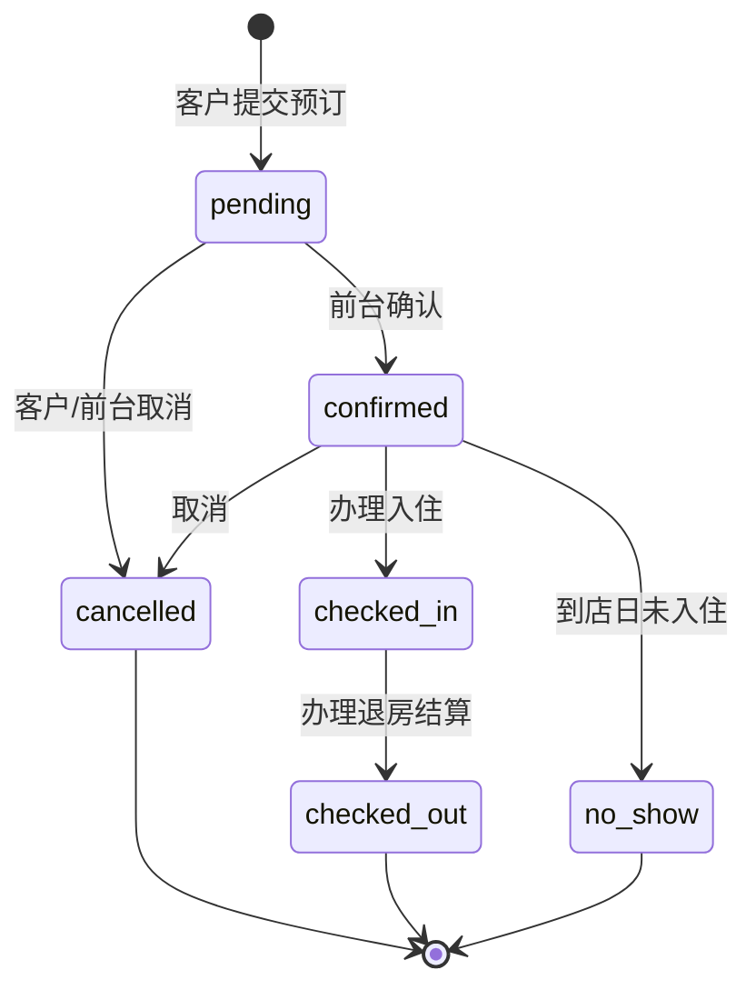
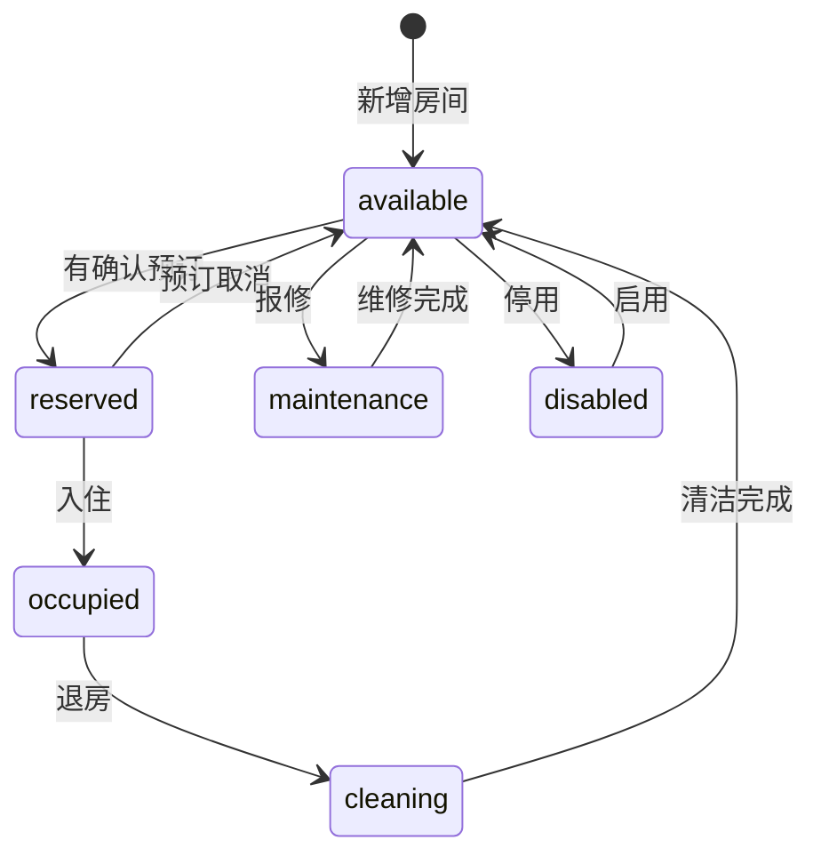

# 02 数据库设计

> 项目：云栖酒店客房预订与入住管理系统（第 14 组）
> 对应脚本：`sql/01_schema.sql`（建表）、`sql/02_constraints.sql`（业务约束/触发器/视图/函数）
> 状态：**设计已落盘，脚本待实跑验证**（实跑后如有差异，以 `psql -f` 的输出为准并回填本文件）
> 本文是报告 3.2 的素材池：3.2.1 ER 图、3.2.2 表结构与约束、3.2.3 数据样例都从这里取，不要另写一份。

## 1 设计目标与策略

课程评分里数据库设计占 50%，所以本项目的策略是**把业务规则尽量下沉到数据库**，应用层只负责把错误翻译成中文提示：

1. **数据完整性交给约束**：主外键、`CHECK`、`UNIQUE`、`EXCLUDE`。会议室式的硬性规则（同一房间不能重叠预订、同一客户不能重复占用）全部在库里拦住，不依赖前端校验。
2. **状态可追溯**：房态变更写 `room_status_log`，谁在何时把房间从什么状态改成什么状态都有据可查（触发器自动写）。
3. **时间用范围类型**：预订占用与价格方案都用 `daterange` + GiST 排他约束表达，`timestamptz` 存时刻，不用字符串存日期。
4. **约束显式命名**：`pk_` / `fk_` / `uq_` / `ck_` / `ex_` / `idx_` 前缀，报告 3.2.2 与答辩时可以逐条指认。
5. **一切可重复执行**：脚本先 `DROP … CASCADE` 再重建，任何一次演示都能从零跑通，不依赖手工点选。

## 2 实体与关系（ER）

### 2.1 关系说明

| 关系 | 基数 | 说明 |
| --- | --- | --- |
| `app_user` ↔ `customer` | 1 : 0..1 | 有账号的客户才绑定档案；线下散客无账号，`customer.user_id` 为空 |
| `customer` → `reservation` | 1 : N | 一个客户可多次预订 |
| `room_type` → `room` | 1 : N | 一个房型下多个房间 |
| `room_type` → `rate_plan` | 1 : N | 一个房型可有多个日期区间的价格方案 |
| `room` → `reservation` | 1 : N | 一个房间在不同日期可被多次预订（区间互斥） |
| `reservation` → `check_in_record` | 1 : 0..1 | 预订办理入住后产生一条入住记录，最多一条 |
| `check_in_record` → `payment` | 1 : N | 一次入住可有多笔收款/退款 |
| `check_in_record` → `service_order` | 1 : N | 增值服务消费（可选表） |
| `service_item` → `service_order` | 1 : N | 服务项目被多次消费（可选表） |
| `room` → `room_status_log` | 1 : N | 房间状态每次变更一条日志 |
| `app_user` → `payment` / `room_status_log` | 1 : N | 记录经办人（可空，系统自动操作时为空） |

### 2.2 ER 图（Mermaid 草稿）

> 报告里的插图用此图导出（draw.io 或无图形界面可用 Mermaid CLI），导出后放 `docs/images/er.png` 并在报告 3.2.1 引用。



## 3 核心设计一：日期区间与排他约束（答辩主攻点）

### 3.1 为什么保留 `date` 列而不是只存 `daterange`

报告 3.2.2 用列清单展示表结构时，`check_in_date` / `check_out_date` 两个 `date` 列最好读、最好和界面字段对应。因此：

- 业务字段保留 `check_in_date`、`check_out_date`（`date`），带 `CHECK (check_out_date > check_in_date)`；
- 另外加**生成列** `during`：

```sql
ALTER TABLE reservation
    ADD COLUMN during daterange
    GENERATED ALWAYS AS (daterange(check_in_date, check_out_date, '[)')) STORED;
```

- `EXCLUDE` 建在生成列上，业务代码不需要维护第三个字段，也不会写下不一致的区间。

### 3.2 排他约束本身

```sql
CREATE EXTENSION IF NOT EXISTS btree_gist;   -- bigint 等值比较需要

ALTER TABLE reservation
    ADD CONSTRAINT ex_reservation_room_overlap
    EXCLUDE USING gist (room_id WITH =, during WITH &&)
    WHERE (status IN ('pending', 'confirmed', 'checked_in'));
```

含义：只要两行预订**房间相同**且**日期区间相交**，并且两行都处于“占用中”的状态，数据库就拒绝插入/更新。

三个设计细节，答辩时必被问：

| 细节 | 取值 | 原因 |
| --- | --- | --- |
| 区间开闭 | `[)` 半开区间 | 12-01 入住、12-03 离店只占 12-01、12-02 两晚；12-03 当天房间可再卖，不会少卖一天 |
| `WHERE` 过滤 | `pending/confirmed/checked_in` | 已取消、已退房、未到店的记录不再占用房间，历史单不能阻塞新房 |
| `btree_gist` | 必须建扩展 | GiST 原生不支持 `bigint =`，`room_id WITH =` 会报 `operator class "bigint_ops" does not exist` |

`rate_plan` 同理，用闭区间 `[valid_from, valid_to]`（“到哪天为止”含当天），约束名 `ex_rate_plan_no_overlap`。

### 3.3 边界用例（报告 3.2.3 / 第 4 章测试用例，全部在库里可复现）

| # | 场景 | 前一条区间 | 后一条区间 | 期望结果 |
| --- | --- | --- | --- | --- |
| B1 | 完全重叠 | `[12-01, 12-03)` | `[12-01, 12-03)` | 拒绝，SQLSTATE `23P01` |
| B2 | 部分重叠 | `[12-01, 12-03)` | `[12-02, 12-04)` | 拒绝，`ex_reservation_room_overlap` |
| B3 | 首尾相接 | `[12-01, 12-03)` | `[12-03, 12-05)` | **允许**（半开区间语义） |
| B4 | 前一条已取消 | `[12-01, 12-03)` 状态 `cancelled` | `[12-01, 12-03)` | 允许（`WHERE` 过滤掉已取消） |
| B5 | 前一条已退房 | `[12-01, 12-03)` 状态 `checked_out` | 同区间 | 允许 |
| B6 | 同客户同房同区间重复提交 | — | 同客户 | 拒绝，`23505`（`uq_reservation_active_customer`） |
| B7 | 跨年 | `[12-30, 01-02)` | `[01-01, 01-03)` | 拒绝（`daterange` 跨年无特殊处理） |
| B8 | 价格方案重叠 | 房型 A `[10-01, 10-07]` | 房型 A `[10-05, 10-10]` | 拒绝，`ex_rate_plan_no_overlap` |
| B9 | 价格方案相接 | 房型 A `[10-01, 10-07]` | 房型 A `[10-08, 10-10]` | 允许（闭区间，不能重叠但可相邻） |

`sql/02_constraints.sql` 末尾有自检 DO 块，实际插入 B2 与 B3 两种数据并把结果打在 NOTICE 里，跑脚本即可看到 23P01 的真实报错文本 —— 这段文本要抄进 Django 的异常映射。

**实测记录（2026-10-30，PostgreSQL 18 中文语言环境）**：

- B2（`__TEST__-2` 插 `[12-02, 12-04)`，与 `__TEST__-1` 的 `[12-01, 12-03)` 相交）→ 被拒，`SQLERRM` = “互相冲突的键值违反排他约束「ex_reservation_room_overlap」”，SQLSTATE `23P01`；
- B3（`__TEST__-3` 插 `[12-03, 12-05)`）→ 成功，验证离店日当天可被下一位客人入住；
- 自检数据已按外键顺序清理，不留测试行。

注意：PG 的错误消息文本随实例 `lc_messages` 变化（本机为中文），**Django 侧按异常类 `psycopg2.errors.ExclusionViolation` 与 `diag.constraint_name` 判定，不要匹配中文文案**。

### 3.4 部分唯一索引（防重复提交）

```sql
CREATE UNIQUE INDEX uq_reservation_active_customer
    ON reservation (customer_id, room_id, check_in_date, check_out_date)
    WHERE status IN ('pending', 'confirmed', 'checked_in');
```

用于 E03（客户重复提交同一区间），抛 `23505`；与 `EXCLUDE` 互补：前者管“同一客户重复下单”，后者管“房间被别人抢”。

## 4 核心设计二：状态机

### 4.1 预订状态



- `checked_in` 只能由入住办理写入，且必须同时创建 `check_in_record`；
- `checked_out` 必须在结算完成（`payment` 覆盖 `total_charge`）后写入；
- E05（取消已入住订单）、E06（重复入住/重复结算）都在应用层按状态机拦截，数据库用 `CHECK` 保证状态值合法。

### 4.2 房间状态



房态变更自动写 `room_status_log`（触发器 `trg_room_status_log`）。

## 5 表清单

共 **11 张**（9 张必选 + 2 张可选），满足课程“≥5 张表”的要求：

| # | 表名 | 说明 | 必选 | 实际行数（`sql/03_seed.sql`） |
| --- | --- | --- | --- | --- |
| 1 | `app_user` | 账号与角色 | ✅ | 9 |
| 2 | `customer` | 客户档案 | ✅ | 7 |
| 3 | `room_type` | 房型 | ✅ | 6 |
| 4 | `room` | 房间 | ✅ | 40 |
| 5 | `rate_plan` | 日期区间价格方案 | ✅ | 10 |
| 6 | `reservation` | 预订主表（核心） | ✅ | 60 |
| 7 | `check_in_record` | 入住与结算记录 | ✅ | 30 |
| 8 | `payment` | 支付/退款流水 | ✅ | 60 |
| 9 | `room_status_log` | 房态变更日志 | ✅ | 33（手工 7 + 触发器 26） |
| 10 | `service_item` | 增值服务项目 | ⬜ 可选 | 4 |
| 11 | `service_order` | 增值服务消费明细 | ⬜ 可选 | 15 |

可选两张表若最终不做增值服务（F07 简化），在 `sql/01_schema.sql` 中整段删除即可，其余表不受影响。

## 6 表结构（报告 3.2.2 直接取用）

字段顺序与 `sql/01_schema.sql` 一致；“约束”列只写该列相关的命名约束，表级约束集中列在 §7。

### 6.1 app_user 账号表

| 字段 | 类型 | 约束 | 说明 |
| --- | --- | --- | --- |
| `id` | `bigserial` | PK `pk_app_user` | 主键 |
| `username` | `varchar(50)` | NOT NULL，`uq_app_user_username` | 登录名，全局唯一 |
| `password` | `varchar(128)` | NOT NULL | Django PBKDF2 密码哈希，不存明文 |
| `display_name` | `varchar(50)` | NOT NULL | 显示姓名 |
| `role` | `varchar(20)` | NOT NULL，`ck_app_user_role` | `customer` / `receptionist` / `admin` |
| `phone` | `varchar(20)` | | 联系电话 |
| `email` | `varchar(120)` | | 邮箱 |
| `is_active` | `boolean` | NOT NULL DEFAULT true | 停用而不删除，保留历史外键 |
| `last_login` | `timestamptz` | | 最近登录时间 |
| `created_at` / `updated_at` | `timestamptz` | NOT NULL DEFAULT `now()` | `updated_at` 由触发器维护 |

### 6.2 customer 客户档案

| 字段 | 类型 | 约束 | 说明 |
| --- | --- | --- | --- |
| `id` | `bigserial` | PK `pk_customer` | |
| `user_id` | `bigint` | FK `fk_customer_user` → `app_user(id)` ON DELETE SET NULL，`uq_customer_user` | 有账号才绑定；散客为空 |
| `name` | `varchar(50)` | NOT NULL | 客户姓名 |
| `phone` | `varchar(20)` | NOT NULL，`uq_customer_phone` | 前台按手机号查预订 |
| `id_card` | `varchar(18)` | `uq_customer_id_card`，`ck_customer_id_card` 长度 15 或 18 | 身份证号 |
| `email` | `varchar(120)` | | |
| `remark` | `varchar(200)` | | |
| `created_at` / `updated_at` | `timestamptz` | NOT NULL DEFAULT `now()` | |

### 6.3 room_type 房型

| 字段 | 类型 | 约束 | 说明 |
| --- | --- | --- | --- |
| `id` | `bigserial` | PK `pk_room_type` | |
| `name` | `varchar(50)` | NOT NULL，`uq_room_type_name` | 如“高级大床房” |
| `bed_type` | `varchar(20)` | NOT NULL，`ck_room_type_bed_type` | `single/double/twin/king/family/suite` |
| `area` | `numeric(5,1)` | `ck_room_type_area`（>0） | 建筑面积（㎡） |
| `capacity` | `smallint` | NOT NULL，`ck_room_type_capacity`（1–8） | 可住人数 |
| `base_price` | `numeric(10,2)` | NOT NULL，`ck_room_type_base_price`（≥0） | 标准价；无价格方案时使用 |
| `description` / `is_active` | `varchar(200)` / `boolean` | `is_active` NOT NULL DEFAULT true | 停用后不出现在可用房查询 |

### 6.4 room 房间

| 字段 | 类型 | 约束 | 说明 |
| --- | --- | --- | --- |
| `id` | `bigserial` | PK `pk_room` | |
| `room_type_id` | `bigint` | NOT NULL，FK `fk_room_room_type` ON DELETE RESTRICT | 所属房型 |
| `room_no` | `varchar(10)` | NOT NULL，`uq_room_room_no` | 房号，唯一 |
| `floor` | `smallint` | NOT NULL，`ck_room_floor`（-2–99） | 楼层 |
| `orientation` | `varchar(10)` | `ck_room_orientation` | `north/south/east/west` |
| `status` | `varchar(20)` | NOT NULL DEFAULT `available`，`ck_room_status` | 六态，见 §4.2 |
| `remark` | `varchar(200)` | | |
| `created_at` / `updated_at` | `timestamptz` | NOT NULL DEFAULT `now()` | |

### 6.5 rate_plan 价格方案

| 字段 | 类型 | 约束 | 说明 |
| --- | --- | --- | --- |
| `id` | `bigserial` | PK `pk_rate_plan` | |
| `room_type_id` | `bigint` | NOT NULL，FK `fk_rate_plan_room_type` ON DELETE CASCADE | 所属房型 |
| `name` | `varchar(50)` | | 如“国庆加价” |
| `price` | `numeric(10,2)` | NOT NULL，`ck_rate_plan_price`（≥0） | 该区间每晚价格 |
| `valid_from` / `valid_to` | `date` | NOT NULL，`ck_rate_plan_range`（`valid_to >= valid_from`） | 生效起止日（含） |
| `valid_during` | `daterange` | 生成列 `daterange(valid_from, valid_to, '[]')` STORED | 供 `ex_rate_plan_no_overlap` 使用 |

### 6.6 reservation 预订主表（核心）

| 字段 | 类型 | 约束 | 说明 |
| --- | --- | --- | --- |
| `id` | `bigserial` | PK `pk_reservation` | |
| `reservation_no` | `varchar(20)` | NOT NULL，`uq_reservation_no` | 业务预订号，如 `R20261203001` |
| `customer_id` | `bigint` | NOT NULL，FK `fk_reservation_customer` ON DELETE RESTRICT | 预订客户 |
| `room_id` | `bigint` | NOT NULL，FK `fk_reservation_room` ON DELETE RESTRICT | 预订房间 |
| `check_in_date` | `date` | NOT NULL | 入住日（含） |
| `check_out_date` | `date` | NOT NULL，`ck_reservation_date_order`（`>`） | 离店日（不含） |
| `during` | `daterange` | 生成列 `daterange(check_in_date, check_out_date, '[)')` STORED | 供排他约束使用 |
| `guest_count` | `smallint` | NOT NULL DEFAULT 1，`ck_reservation_guest_count`（>0） | 入住人数 |
| `price_per_night` | `numeric(10,2)` | NOT NULL，快照 | 下单时房价，改价不影响历史单 |
| `total_amount` | `numeric(10,2)` | NOT NULL，`ck_reservation_price`（≥0） | 晚数 × `price_per_night` |
| `status` | `varchar(20)` | NOT NULL DEFAULT `pending`，`ck_reservation_status` | 六态，见 §4.1 |
| `source` | `varchar(20)` | NOT NULL DEFAULT `online`，`ck_reservation_source` | `online/phone/walk_in` |
| `remark` | `varchar(200)` | | |
| `created_at` / `updated_at` | `timestamptz` | NOT NULL DEFAULT `now()` | |

表级约束：`ex_reservation_room_overlap`（防超卖）、`uq_reservation_active_customer`（防重复提交）。

### 6.7 check_in_record 入住与结算

| 字段 | 类型 | 约束 | 说明 |
| --- | --- | --- | --- |
| `id` | `bigserial` | PK `pk_check_in_record` | |
| `reservation_id` | `bigint` | NOT NULL，FK `fk_check_in_record_reservation` ON DELETE RESTRICT，`uq_check_in_record_reservation` | 一条预订最多一条入住记录 |
| `guest_name` / `guest_phone` | `varchar(50)` / `varchar(20)` | NOT NULL | 实际入住人（可与预订人不同） |
| `guest_id_card` | `varchar(18)` | `ck_check_in_record_guest_id` 长度 15/18 | 实际入住人证件 |
| `check_in_at` | `timestamptz` | NOT NULL DEFAULT `now()` | 实际入住时刻 |
| `actual_checkout_at` | `timestamptz` | `ck_check_in_record_time_order`（不早于入住） | 为空表示仍在住 |
| `deposit_amount` | `numeric(10,2)` | NOT NULL DEFAULT 0，`ck_check_in_record_amounts`（≥0） | 押金 |
| `room_charge` | `numeric(10,2)` | 同上 | 房费 = 实住天数 × 适用房价 |
| `service_charge` | `numeric(10,2)` | 同上 | 增值服务费合计 |
| `total_charge` | `numeric(10,2)` | 同上 | 应收合计 = 房费 + 服务费 |
| `remark` | `varchar(200)` | | |
| `created_at` / `updated_at` | `timestamptz` | NOT NULL DEFAULT `now()` | |

### 6.8 payment 支付/退款流水

| 字段 | 类型 | 约束 | 说明 |
| --- | --- | --- | --- |
| `id` | `bigserial` | PK `pk_payment` | |
| `payment_no` | `varchar(20)` | NOT NULL，`uq_payment_no` | 流水号 |
| `check_in_record_id` | `bigint` | NOT NULL，FK `fk_payment_check_in_record` ON DELETE CASCADE | 所属入住记录 |
| `kind` | `varchar(20)` | NOT NULL，`ck_payment_kind` | `deposit/room_fee/service_fee/refund` |
| `method` | `varchar(20)` | NOT NULL，`ck_payment_method` | `cash/card/wechat/alipay` |
| `amount` | `numeric(10,2)` | NOT NULL，`ck_payment_amount`（≥0） | 退款也记正数，用 `kind` 区分方向 |
| `paid_at` | `timestamptz` | NOT NULL DEFAULT `now()` | 收付时间 |
| `operator_user_id` | `bigint` | FK `fk_payment_operator` ON DELETE SET NULL | 经办前台 |
| `remark` | `varchar(200)` | | |

### 6.9 room_status_log 房态变更日志

| 字段 | 类型 | 约束 | 说明 |
| --- | --- | --- | --- |
| `id` | `bigserial` | PK `pk_room_status_log` | |
| `room_id` | `bigint` | NOT NULL，FK `fk_room_status_log_room` ON DELETE CASCADE | 房间 |
| `from_status` | `varchar(20)` | `ck_room_status_log_from` | 变更前（首次为空） |
| `to_status` | `varchar(20)` | NOT NULL，`ck_room_status_log_to` | 变更后 |
| `changed_by` | `bigint` | FK `fk_room_status_log_user` ON DELETE SET NULL | 操作人；系统自动为空 |
| `changed_at` | `timestamptz` | NOT NULL DEFAULT `now()` | 变更时间 |
| `reason` | `varchar(200)` | | 变更原因 |

### 6.10 service_item 增值服务项目（可选）

| 字段 | 类型 | 约束 | 说明 |
| --- | --- | --- | --- |
| `id` | `bigserial` | PK `pk_service_item` | |
| `code` | `varchar(20)` | NOT NULL，`uq_service_item_code` | 服务编码 |
| `name` | `varchar(50)` | NOT NULL，`uq_service_item_name` | 服务名称（早餐/洗衣/接送） |
| `unit` | `varchar(10)` | NOT NULL DEFAULT `份` | 计量单位 |
| `price` | `numeric(10,2)` | NOT NULL，`ck_service_item_price`（≥0） | 单价 |
| `is_active` | `boolean` | NOT NULL DEFAULT true | 是否在售 |

### 6.11 service_order 增值服务消费（可选）

| 字段 | 类型 | 约束 | 说明 |
| --- | --- | --- | --- |
| `id` | `bigserial` | PK `pk_service_order` | |
| `check_in_record_id` | `bigint` | NOT NULL，FK `fk_service_order_check_in_record` ON DELETE CASCADE | 所属入住记录 |
| `service_item_id` | `bigint` | NOT NULL，FK `fk_service_order_service_item` ON DELETE RESTRICT | 服务项目 |
| `quantity` | `integer` | NOT NULL，`ck_service_order_quantity`（>0） | 数量 |
| `unit_price` | `numeric(10,2)` | NOT NULL，`ck_service_order_unit_price`（≥0） | 消费时单价快照 |
| `amount` | `numeric(10,2)` | 生成列 `quantity * unit_price` STORED | 金额 |
| `ordered_at` | `timestamptz` | NOT NULL DEFAULT `now()` | 消费时间 |

## 7 约束清单（答辩逐条指认用）

### 7.1 主键与唯一

| 约束名 | 表 | 定义 | 业务含义 |
| --- | --- | --- | --- |
| `pk_*` | 全部 11 张表 | `PRIMARY KEY (id)` | 代理主键 |
| `uq_app_user_username` | `app_user` | `UNIQUE (username)` | 登录名不重名 |
| `uq_customer_user` | `customer` | `UNIQUE (user_id)` | 一个账号只能绑一个客户档案 |
| `uq_customer_phone` | `customer` | `UNIQUE (phone)` | 手机号即客户身份，防重复建档 |
| `uq_customer_id_card` | `customer` | `UNIQUE (id_card)` | 同一身份证不得重复建档 |
| `uq_room_type_name` | `room_type` | `UNIQUE (name)` | 房型名唯一 |
| `uq_room_room_no` | `room` | `UNIQUE (room_no)` | 房号唯一 |
| `uq_reservation_no` | `reservation` | `UNIQUE (reservation_no)` | 预订号唯一 |
| `uq_check_in_record_reservation` | `check_in_record` | `UNIQUE (reservation_id)` | E06：一单不能入住两次 |
| `uq_payment_no` | `payment` | `UNIQUE (payment_no)` | 流水号唯一 |
| `uq_service_item_code` / `_name` | `service_item` | `UNIQUE` | 服务编码/名称唯一 |

### 7.2 外键

| 约束名 | 子表.列 | 父表 | 删除策略 | 原因 |
| --- | --- | --- | --- | --- |
| `fk_customer_user` | `customer.user_id` | `app_user` | SET NULL | 账号注销后保留客户档案与历史单 |
| `fk_room_room_type` | `room.room_type_id` | `room_type` | RESTRICT | E08：房型下有房间不能删，改停用 |
| `fk_rate_plan_room_type` | `rate_plan.room_type_id` | `room_type` | CASCADE | 房型删除时价格方案随之清理 |
| `fk_reservation_customer` | `reservation.customer_id` | `customer` | RESTRICT | 有历史订单的客户不能删 |
| `fk_reservation_room` | `reservation.room_id` | `room` | RESTRICT | 有历史订单的房间不能删 |
| `fk_check_in_record_reservation` | `check_in_record.reservation_id` | `reservation` | RESTRICT | 结算记录不能失去来源 |
| `fk_payment_check_in_record` | `payment.check_in_record_id` | `check_in_record` | CASCADE | 入住记录删除时流水一并清 |
| `fk_payment_operator` | `payment.operator_user_id` | `app_user` | SET NULL | 经办人离职不影响流水 |
| `fk_room_status_log_room` | `room_status_log.room_id` | `room` | CASCADE | 房间删除时日志随之清 |
| `fk_room_status_log_user` | `room_status_log.changed_by` | `app_user` | SET NULL | 同上 |
| `fk_service_order_check_in_record` | `service_order.check_in_record_id` | `check_in_record` | CASCADE | 同上 |
| `fk_service_order_service_item` | `service_order.service_item_id` | `service_item` | RESTRICT | 服务项目被消费过不能删 |

### 7.3 CHECK 约束

| 约束名 | 定义 | 拦截的异常 |
| --- | --- | --- |
| `ck_app_user_role` | `role IN ('customer','receptionist','admin')` | 非法角色 |
| `ck_customer_id_card` | 长度 15 或 18 | 证件号格式 |
| `ck_room_type_bed_type` | `IN (...)` | 非法床型 |
| `ck_room_type_area` | `area > 0` | 面积非法 |
| `ck_room_type_capacity` | `1..8` | 人数非法 |
| `ck_room_type_base_price` | `>= 0` | 负价格 |
| `ck_room_floor` | `-2..99` | 楼层非法 |
| `ck_room_orientation` | `IN (...)` | 朝向非法 |
| `ck_room_status` | 六态 | 非法房态 |
| `ck_rate_plan_price` / `ck_rate_plan_range` | `price >= 0`；`valid_to >= valid_from` | 负价格、倒置区间 |
| `ck_reservation_date_order` | `check_out_date > check_in_date` | 同日或倒置日期（E01 的第一道库内保障） |
| `ck_reservation_guest_count` | `guest_count > 0` | 人数为 0 |
| `ck_reservation_price` | `price_per_night >= 0 AND total_amount >= 0` | 负金额 |
| `ck_reservation_status` / `ck_reservation_source` | 枚举 | 非法状态/来源 |
| `ck_check_in_record_time_order` | 退房时间不早于入住 | 时间倒置 |
| `ck_check_in_record_amounts` | 四项费用均 ≥ 0 | 负押金/负房费 |
| `ck_check_in_record_guest_id` | 证件长度 15/18 | 证件格式 |
| `ck_payment_kind` / `ck_payment_method` / `ck_payment_amount` | 枚举；`amount >= 0` | 非法支付类型、负金额 |
| `ck_room_status_log_from` / `_to` | 六态 | 非法状态 |
| `ck_service_item_price` | `>= 0` | 负价格 |
| `ck_service_order_quantity` / `_unit_price` | `> 0` / `>= 0` | 数量/单价非法 |

### 7.4 排他约束（EXCLUDE）

| 约束名 | 表 | 定义 | 拦截的异常 |
| --- | --- | --- | --- |
| `ex_reservation_room_overlap` | `reservation` | `gist (room_id WITH =, during WITH &&) WHERE status IN ('pending','confirmed','checked_in')` | **超卖**（E02） |
| `ex_rate_plan_no_overlap` | `rate_plan` | `gist (room_type_id WITH =, valid_during WITH &&)` | 价格方案区间重叠 |

### 7.5 部分唯一索引

| 索引名 | 表 | 定义 | 拦截的异常 |
| --- | --- | --- | --- |
| `uq_reservation_active_customer` | `reservation` | `UNIQUE (customer_id, room_id, check_in_date, check_out_date) WHERE status IN ('pending','confirmed','checked_in')` | 客户重复提交（E03） |

## 8 索引设计

| 索引名 | 表 | 列 | 用途 |
| --- | --- | --- | --- |
| `idx_reservation_customer` | `reservation` | `(customer_id)` | 我的预订列表（F05） |
| `idx_reservation_room_dates` | `reservation` | `(room_id, check_in_date, check_out_date)` | 房态看板按房查占用（F08） |
| `idx_reservation_status` | `reservation` | `(status)` | 前台按待确认/待入住筛选 |
| `idx_payment_record` | `payment` | `(check_in_record_id)` | 结算页取流水 |
| `idx_payment_paid_at` | `payment` | `(paid_at)` | 月度营业统计（F09） |
| `idx_room_status_log_room` | `room_status_log` | `(room_id, changed_at DESC)` | 房态追溯按时间倒序 |
| `idx_service_order_record` | `service_order` | `(check_in_record_id)` | 结算页取服务明细 |

`EXCLUDE` 约束本身会创建一个同名 GiST 索引（`ex_reservation_room_overlap` / `ex_rate_plan_no_overlap`），可用 `pg_indexes` 看到，报告里也值得截图。

## 9 触发器、视图与函数

### 9.1 触发器

| 触发器 | 表 | 时机 | 作用 |
| --- | --- | --- | --- |
| `trg_*_updated_at`（7 个） | `app_user`、`customer`、`room_type`、`room`、`rate_plan`、`reservation`、`check_in_record` | BEFORE UPDATE FOR EACH ROW | 自动刷新 `updated_at` |
| `trg_room_status_log` | `room` | AFTER UPDATE OF `status` | 自动写 `room_status_log`，操作人从 `SET LOCAL app.current_user_id` 取 |

### 9.2 视图

| 视图 | 内容 | 用途 |
| --- | --- | --- |
| `v_reservation_detail` | 预订 + 客户 + 房间 + 房型，含 `nights`、房型名 | 预订列表页、报告 4 章多表查询 |
| `v_check_in_detail` | 入住记录 + 已收退金额合计 + 差额 `balance` | 退房结算页（押金是否足够，E07） |

### 9.3 函数

| 函数 | 说明 | 用途 |
| --- | --- | --- |
| `fn_available_rooms(p_check_in date, p_check_out date, p_room_type_id bigint default null)` | 返回可用房及首晚价格；条件：房态非维修/停用、房型在售、无相交的生效预订 | F03 可用房查询（服务端手写 SQL，报告 4 章可贴） |
| `fn_set_updated_at()` | 通用 `updated_at` 触发器函数 | 内部 |
| `fn_log_room_status()` | 房态日志触发器函数 | 内部 |

## 10 数据样例规划

详细种子数据写在 `sql/03_seed.sql`，规则：

1. **房型 6 种**（标准间 / 高级大床房 / 豪华双床房 / 家庭房 / 行政套房 / 无障碍房），价格 288–1288 元/晚；
2. **房间 40 间**，分布在 5–12 层，房号 `5xx`–`12xx`，覆盖全部六种房态（至少各有 1 间）；
3. **账号**：管理员 1、前台 2、客户账号 6，密码统一 `Hotel@123`（演示时说明这是演示库口令）；
4. **预订 60 条**：覆盖六种状态，包含 §3.3 的 B3（首尾相接）、B4（已取消后重订）两组合法数据；**不放任何重叠数据**，重叠只出现在自检脚本里；
5. **入住记录 30 条**、**支付流水 60 笔**（含至少 2 笔 `refund`，验证 E07 押金不足场景由测试脚本构造）；
6. 日期锚点：以 2026-12 为主，跨年数据 2 组（B7），保证查询演示有跨月/跨年结果；
7. 种子脚本必须可重复执行：先 `TRUNCATE … RESTART IDENTITY CASCADE`，再按外键顺序插入。

**生成方式（2026-10-30）**：`sql/03_seed.sql` 由 `tools/build_seed_sql.py` 生成，不手写。原因有三：

- 60 条预订必须满足「同一房间的活跃区间互不重叠」，脚本在 Python 侧维护 `busy[room_id]` 区间表，落库前就做冲突检测，不靠 psql 试错；
- 条数口径要跟本节完全一致，脚本末尾 `assert` 校验（预订 60 / 入住 30 / 支付 60：押金 30 + 房费 23 + 退款 2 + 在住服务费 5 / 房态六种各 ≥1）；
- 固定随机种子 `20261030`，改数据只改脚本再重跑，输出可 diff。

实际生成结果（脚本自报）：`reservation` 状态分布 checked_out 25、cancelled 6、no_show 4、checked_in 5、pending 8、confirmed 12；`room` 状态 available 14、reserved 17、occupied 5、cleaning 2、maintenance 1、disabled 1。种子账号口令统一 `Hotel@123`（哈希由 Django 6.1.2 `make_password` 生成，`pbkdf2_sha256$1500000$…`）。

报告 3.2.3 的样例数据表直接取 `reservation` + `v_reservation_detail` 的 5–8 行，配 `sql/04_queries.sql` 的查询结果截图。

## 11 与 Django 的衔接

1. **表由 SQL 脚本创建，Django 模型 `managed = False`**：`sql/` 是唯一事实来源，避免 migration 与脚本两份 DDL 漂移；Django 只跑 `migrate` 建 `auth_*` / `contenttypes` / `sessions` 等框架表（自定义用户模型 `AUTH_USER_MODEL = 'core.AppUser'` 对应 `app_user` 表，`managed = False`）。
2. **执行顺序**：`psql -f sql/00_database.sql` → `01_schema.sql` → `02_constraints.sql` → `03_seed.sql`，再 `python manage.py migrate`（框架表）。
3. **异常映射**（`core/services.py` 或视图层统一处理）：
   - `psycopg2.errors.ExclusionViolation`（SQLSTATE **23P01**）→ “该房间在所选日期已被预订，请换一间或调整日期”；
   - `psycopg2.errors.UniqueViolation`（**23505**）且约束名含 `uq_reservation_active_customer` → “您已提交过相同区间、相同房间的预订”；
   - `psycopg2.errors.CheckViolation`（**23514**）→ 按约束名映射到具体字段文案（如 `ck_reservation_date_order` → “离店日期必须晚于入住日期”）。
4. **复杂查询走手写 SQL**：可用房、入住率、月度营收都用 `connection.cursor()` 或 `QuerySet.raw()`，报告 4 章贴真实执行 SQL（对应 `sql/04_queries.sql`）。
5. **事务**：办理入住 = 更新 `reservation.status` + 插入 `check_in_record` + 更新 `room.status`（触发日志），放在同一个 `transaction.atomic()` 里；靠库约束兜底，不做应用层双重校验的补丁。

## 12 待办与核对

- [x] `sql/01_schema.sql` / `02_constraints.sql` 实跑通过（2026-10-30，psql 输出：建表 11 张、`table_count = 11`；排他约束 2 条 `ex_reservation_room_overlap` / `ex_rate_plan_no_overlap`；部分唯一索引 1 条；触发器 8 个；视图 2 个；函数 2 个）
- [x] 排他约束自检：`sql/02_constraints.sql` 末尾 DO 块已实测——重叠预订被拒并抛 SQLSTATE **23P01**（PG 中文消息“互相冲突的键值违反排他约束 `ex_reservation_room_overlap`”），相邻区间成功插入，半开区间语义正确
- [x] `sql/03_seed.sql` 按 §10 生成（`tools/build_seed_sql.py`，种子 20261030）并**实跑通过**（2026-10-30）：11 张表行数 `9/7/6/40/10/60/30/60/33/4/15`；预订状态 `checked_out 25 / confirmed 12 / pending 8 / cancelled 6 / checked_in 5 / no_show 4`；房态 `available 14 / reserved 17 / occupied 5 / cleaning 2 / maintenance 1 / disabled 1`；重叠检测 `overlap_pairs = 0`；支付 `deposit 30/10710.00、room_fee 23/23170.00、refund 2/200.00、service_fee 5/848.00`；`fn_available_rooms(2026-12-20, 12-22)` 返回 34 间可订房；两个视图行数 60 / 30
- [ ] `sql/04_queries.sql` 覆盖 docs/01 §8 的 6 类查询 + 可用房函数调用
- [ ] ER 图导出 PNG 放 `docs/images/er.png`，报告 3.2.1 引用
- [ ] 报告 3.2.2 逐表截图 `\d+ 表名`（含 COMMENT）与 `pg_constraint` 清单
- 术语统一：约束命名一律 `ex_` 前缀（排他），`uq_` 前缀（唯一），与 `docs/01` §7 示例代码保持一致
- 控制台编码：Windows 下 psql 客户端默认 GBK，脚本首行 `\encoding UTF8` 已在任何中文字面量之前生效；回显仍可能是乱码，不影响入库数据
